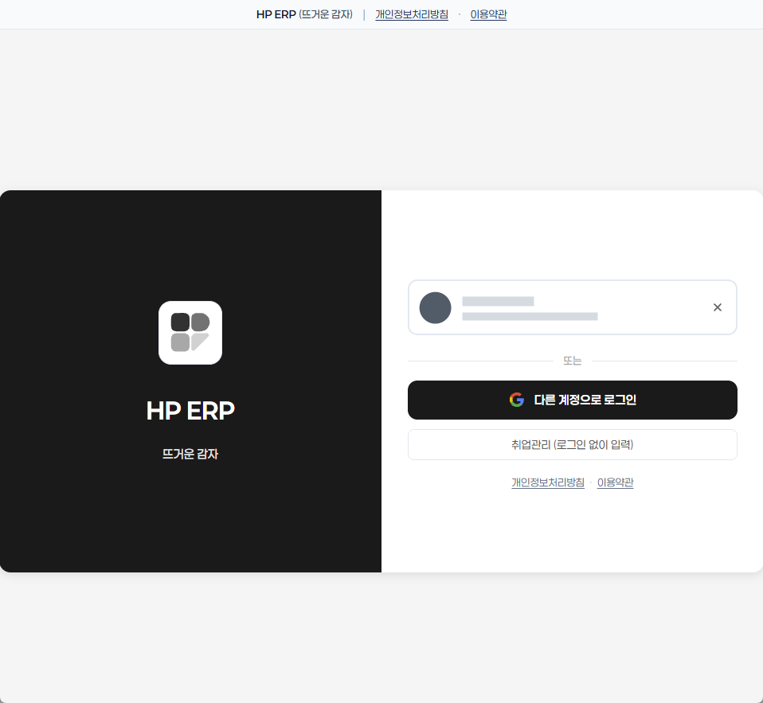
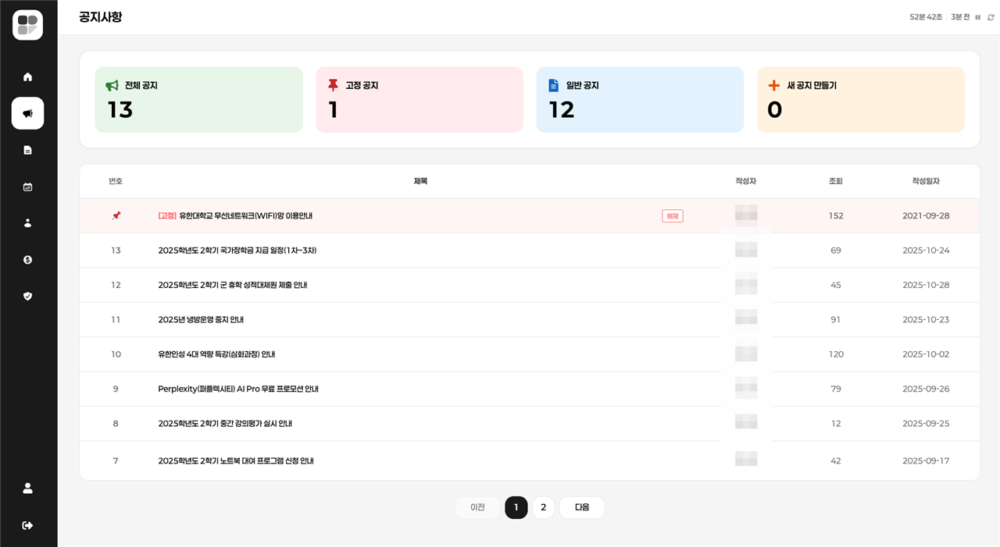
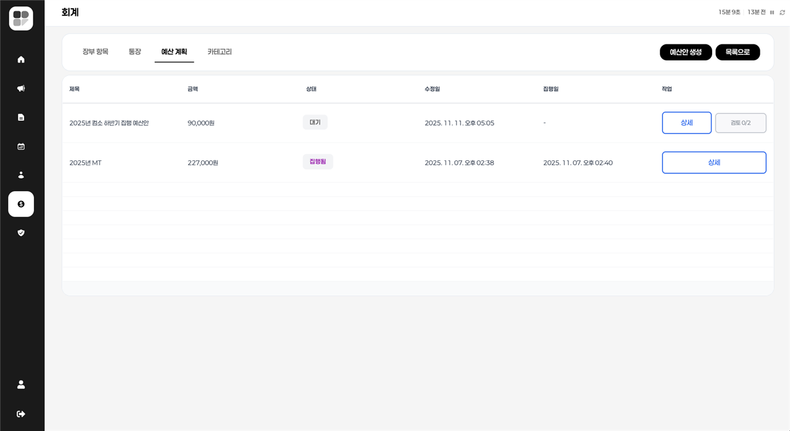
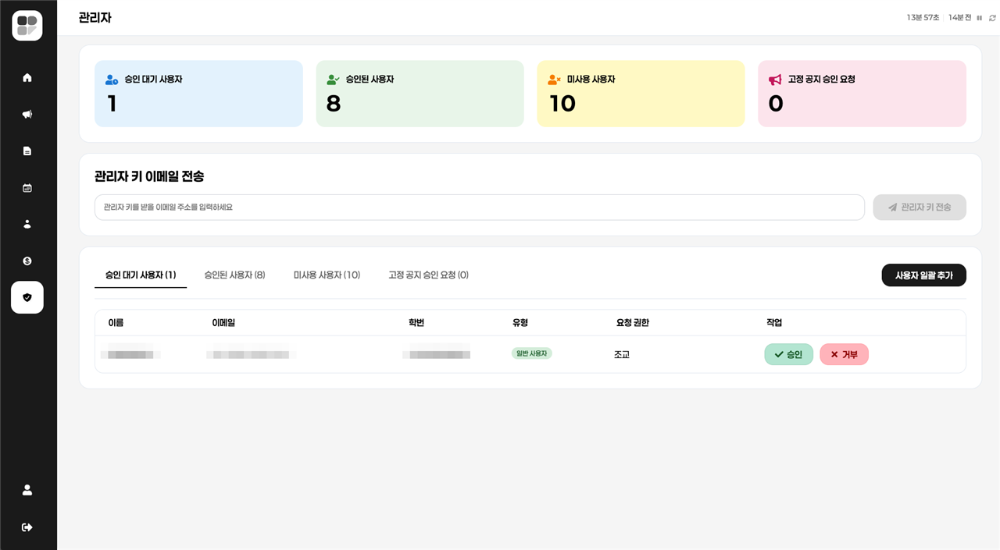
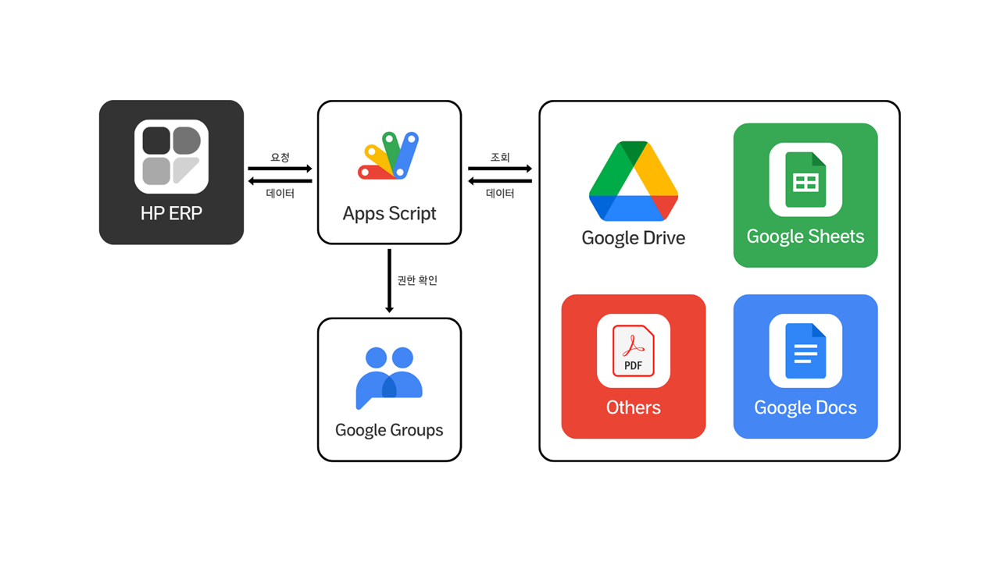
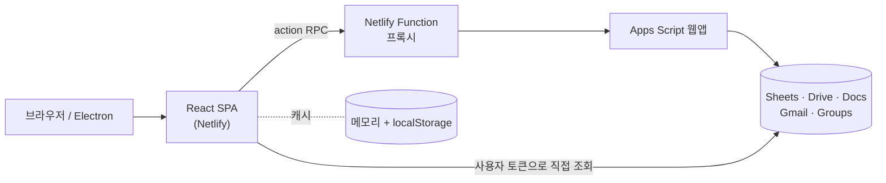

# HP ERP (뜨거운 감자)

학과 행정 업무(결재, 문서, 공지, 일정, 학생회비 장부, 학적)를 **Google Workspace 위에서 한곳에 모은 학과용 ERP**입니다.
서버와 DB 없이 Google Sheets를 데이터베이스로, Apps Script를 백엔드로 씁니다.

**운영 보류 상태:** https://yuhancse.netlify.app

[](https://react.dev/)
[](https://www.typescriptlang.org/)
[](https://vitejs.dev/)
[](https://developers.google.com/apps-script)
[](https://yuhancse.netlify.app)

## 만들게 된 이유

학과 업무에는 따로 시스템이 없었습니다. 결재는 문서를 출력해서 교수님을 찾아가 서명을 받았고, 반려되면 다시 출력했습니다. 양식은 메일과 메신저로 돌았고, 공지는 단체방에 묻혔고, 학생회비 장부와 영수증은 담당자만 알고 있었습니다.

새 서버를 들이기엔 예산도 운영할 사람도 없었습니다. 대신 학과 구성원 모두가 이미 Google 계정을 쓰고 있었습니다. 그래서 **이미 쓰고 있는 Drive·Sheets·Docs·Calendar 위에 업무 흐름만 얹자**는 방향을 잡았습니다. 로그인도 저장소도 Google 것을 그대로 쓰고, 결과물(결재 문서, 장부)은 평소처럼 Google 화면에서 열 수 있습니다.

문제 정의와 범위는 [docs/PROBLEM_DEFINITION.md](docs/PROBLEM_DEFINITION.md)에 정리했습니다.

## 주요 기능

- **결재**: 검토선과 결재선을 나눠 단계별로 승인·반려·보류하고, 반려되면 고쳐서 다시 올립니다. 모든 처리는 이력으로 남습니다.
- **문서·양식**: 공유 양식으로 문서를 바로 만들고, "나만 보기" 또는 지정한 그룹에 편집 권한을 줍니다.
- **공지사항**: 역할 그룹이나 개인 단위로 공개 범위를 정하고, 관리자 승인을 받아 상단에 고정합니다.
- **회계**: 장부마다 전용 폴더와 증빙 폴더를 만들고, 입출금과 영수증을 함께 기록합니다. 예산 계획은 부관리인 검토 → 주관리인 승인 → 집행 순서로 처리됩니다.
- **일정**: 교수·학생·학생회·조교 캘린더를 합쳐 보고, 개인 시간표도 관리합니다.
- **학적**: 학생·교직원·위원회 관리, 학기 말 학년 일괄 갱신과 졸업 처리, 졸업생 취업 정보 입력(로그인 없이)
- **가입 관리**: 학번·이름 사전 등록 + 관리자 승인제. 승인하면 역할별 Google 그룹에 자동으로 추가합니다.
- **대시보드**: 위젯을 골라 배치하고, 배치는 각자 드라이브에 저장됩니다.

## 화면

<p align="center"></p>

<table>
  <tr>
    <td align="center"><br>대시보드 (위젯)</td>
    <td align="center"><br>공지사항</td>
  </tr>
  <tr>
    <td align="center"><br>문서 결재 요청</td>
    <td align="center"><br>일정 (월간)</td>
  </tr>
  <tr>
    <td align="center"><br>회계 · 예산 계획</td>
    <td align="center"><br>관리자 · 가입 승인</td>
  </tr>
</table>

<p align="center"><br>시스템 구성: HP ERP ↔ Apps Script ↔ Google Drive · Sheets · Docs · Groups</p>

로그인 외 화면은 원본 시점(2025년 11월)의 캡스톤디자인 작품보고서에 실린 캡처입니다. 개인정보(이름·이메일·학번)와 장부 잔액은 모자이크 처리했습니다.

## 팀

원본 프로젝트(2025.07 ~ 2025.12, 666커밋)는 6명이 함께 만들었고, 리메이크(2025.11 ~ )는 원본을 정리하고 기능을 보강하는 작업입니다. 아래 역할은 두 저장소의 커밋 이력에서 각자 가장 많이 작업한 영역입니다.

<table>
  <tr>
    <td align="center"><br><b>김형균</b></td>
    <td align="center"><br><b>김나윤</b></td>
    <td align="center"><br><b>문준영</b></td>
    <td align="center"><br><b>용지순</b></td>
    <td align="center"><br><b>장환희</b></td>
    <td align="center"><br><b>안창희</b></td>
  </tr>
  <tr>
    <td>Apps Script 백엔드, 회계, 결재, 관리자, 공통 유틸·타입, 배포, 리메이크</td>
    <td>공지사항, 문서 양식 UI, 새 문서·문서함</td>
    <td>캘린더, 양식 UI, 공통 UI 컴포넌트</td>
    <td>디자인 시스템(스타일·아이콘), 레이아웃, 화면 UI</td>
    <td>캘린더, 시간표, 대시보드</td>
    <td>대시보드 위젯</td>
  </tr>
</table>

리메이크에는 최가은(환경변수 전환 정리)과 김용빈(루트 폴더 기준 탐색), 임지섭(appScript 처리 안정화)도 참여했습니다.

## 기술 스택

| 구분 | 사용 기술 |
|---|---|
| Frontend | React 19, TypeScript 5, Vite 5, Zustand, Tiptap, Recharts, rrule |
| Backend | Google Apps Script (V8), Netlify Functions (프록시) |
| 저장소 | Google Sheets(데이터), Google Drive(파일), 자체 Sheets 모듈 `sheetsClient`(이전 papyrus-db 대체) |
| 인증 | Google OAuth 2.0 (`drive.file` 등 최소 범위만 요청). Apps Script가 요청마다 액세스 토큰으로 요청자를 확인 |
| 연동 | Google Docs·Calendar·Gmail·Groups(Admin SDK). Gmail은 Apps Script가 관리자 키 메일을 보낼 때만 씀 |
| 배포 | Netlify(웹), Electron 38(데스크톱, 선택) |
| 품질 | Jest, Testing Library, ESLint 9, Prettier |

## 구조



설계하면서 고민한 부분입니다. 전체 결정 기록은 [docs/ADR.md](docs/ADR.md)에 있습니다.

- **DB 서버 대신 Google Sheets를 썼습니다.**
  운영비가 없었고, 운영을 맡을 조교는 DB는 못 다뤄도 스프레드시트는 다룰 수 있었습니다. 시트를 열면 데이터를 바로 확인하고 고칠 수 있다는 점이 컸습니다. 대신 FK·트랜잭션이 없어서 무결성은 코드가 지켜야 하고, 열 순서가 바뀌면 코드가 깨진다는 대가가 있었습니다.
- **데이터 접근 경로를 둘로 나눴습니다.**
  회원·결재·공지처럼 권한 검사나 Drive 조작이 필요한 일은 Apps Script를 거치고, 캘린더·학생 목록·장부처럼 자주 읽는 데이터는 브라우저가 사용자 토큰으로 Sheets를 직접 읽습니다. 직접 읽는 데이터는 Drive 공유 권한으로 접근을 막을 수 있어서 이렇게 나눴고, 그만큼 Apps Script 호출과 대기 시간이 줄었습니다.
- **장부마다 스프레드시트를 따로 만들었습니다.**
  학생회비 장부와 행사비 장부는 보는 사람이 다릅니다. 장부를 만들 때 전용 폴더·시트·증빙 폴더를 새로 만들고 지정한 사람에게만 공유하면, 별도 권한 시스템 없이 Drive 권한만으로 접근을 나눌 수 있었습니다.
- **Drive 범위를 `drive.file`로 줄였습니다(2026-10-30 운영 반영).**
  전체 Drive 범위(`drive`)는 Google 앱 인증 때 매년 유료 보안 평가가 필요합니다. 브라우저는 이 앱이 만든 파일(개인 폴더 `hot_potato_personal`)만 다루고, 배포자 소유 공유 파일의 업로드·검색·복사는 Apps Script가 맡도록 옮겼습니다. 역할 폴더는 Google 그룹에 공유해서, 파일 접근은 그룹 가입으로 정해집니다([docs/ADR.md](docs/ADR.md) ADR-014).
- **Apps Script가 요청자를 직접 확인합니다(2026-10-30 운영 반영).**
  예전에는 Apps Script가 브라우저가 보낸 이메일·역할 값을 그대로 믿었습니다. 지금은 요청마다 Google 액세스 토큰을 함께 보내고, Apps Script가 Google에 토큰을 확인해 이메일을 얻은 뒤 `hp_member`에서 승인 여부와 관리자 여부를 읽습니다. 액션은 공개·회원·관리자 세 가지로 나눴습니다([docs/ADR.md](docs/ADR.md) ADR-015).

## 트러블슈팅

### 1. 로그인 직후 Apps Script 호출이 몰려 첫 화면이 늦고 429가 나던 문제

화면마다 필요한 데이터를 각자 Apps Script에 요청하다 보니, 로그인 직후 요청이 한꺼번에 몰렸습니다. Apps Script는 응답이 느리고 계정별 할당량이 있어서 첫 화면이 늦게 떴고, 사용자가 몰리면 429(요청 과다)가 났습니다.

요청 흐름을 다시 짰습니다.
- 스프레드시트 ID는 이름 목록을 한 번에 보내 한 번에 받습니다.
- 꼭 필요한 데이터(공지, 캘린더, 템플릿, 장부 목록)는 **동시 8개씩** 먼저 받고, 나머지(문서, 학생, 교직원, 내 결재)는 화면을 막지 않고 뒤에서 받습니다.
- 응답은 메모리 + localStorage 캐시에 **데이터 종류별 TTL**(결재 3분 ~ 장부 목록 45분)로 보관해, 같은 데이터를 다른 화면에서 다시 요청하면 캐시에서 꺼냅니다.
- 쓰기가 성공하면 그 액션과 관련된 캐시 키만 지우고 다시 받습니다.
- 그래도 429가 오면 서버가 알려 준 대기 시간을 지키고, 해당 데이터의 주기 동기화를 30~120분 멈춥니다.

초기 로딩이 언제, 무엇을, 어디에 저장하는지는 코드 기준으로 따로 정리해 두었습니다([docs/archive/초기_로딩_분석.md](docs/archive/초기_로딩_분석.md)). 캐시 TTL과 동기화 간격은 [docs/ARCHITECTURE.md](docs/ARCHITECTURE.md#92-데이터-로딩과-캐시)에 있습니다.

### 2. 브라우저에서 Apps Script를 부르면 CORS에 막히고, 오류가 HTML로 오던 문제

Apps Script 웹앱은 응답 헤더를 마음대로 정할 수 없어서 브라우저에서 바로 부르면 CORS에 막혔습니다. 웹앱 URL이 클라이언트 번들에 그대로 들어가는 것도 문제였습니다. 또 배포 권한이나 버전이 어긋나면 Apps Script는 JSON 대신 **HTML 페이지**(로그인·권한·오류 화면)를 돌려줍니다. 클라이언트에서는 파싱 오류로만 보여 원인을 구분하기 어렵습니다.

Netlify Function으로 프록시를 두고 다음과 같이 고쳤습니다.
- 웹앱 주소는 서버 전용 환경변수 `APP_SCRIPT_URL`에만 둡니다. 번들에는 들어가지 않습니다.
- Apps Script가 JSON이 아닌 응답을 주면 `{ success:false, error }`로 감싸고, 앞 300자를 Functions 로그에 남깁니다. 이제 로그만 보면 "권한 문제인지, URL 문제인지" 바로 구분됩니다.
- 잘못된 JSON 요청은 400, 지원하지 않는 메서드는 405로 일찍 돌려보냅니다.
- 프로젝트가 ESM(`"type": "module"`)이라 CommonJS로 쓴 함수가 Netlify 빌드에서 문제가 됐고, 함수를 ESM으로 바꿨습니다.

이 증상별 대응은 [docs/RUNBOOK.md](docs/RUNBOOK.md)에 정리해서 운영자도 같은 순서로 확인할 수 있게 했습니다.

### 3. 같은 이름의 파일이 있으면 엉뚱한 시트를 잡을 수 있던 문제

처음에는 폴더·시트 이름이 코드 곳곳에 하드코딩되어 있었고, 스프레드시트를 **드라이브 전체에서 이름으로** 찾았습니다. 같은 이름의 파일이나 폴더가 다른 곳에 있으면 엉뚱한 파일을 잡을 수 있었고, 다른 환경에 설치하려면 코드를 고쳐야 했습니다.

- 폴더·스프레드시트·시트·그룹 이름을 JSON 환경변수 4개(`VITE_FOLER_NAME` 등)로 모으고, Apps Script 쪽은 스크립트 속성으로 옮겼습니다.
- 스프레드시트는 **프로젝트 루트 폴더 아래에서만** 찾도록 바꿨습니다. 루트 폴더는 이름이 아니라 설정값(스크립트 속성의 폴더 ID)을 우선해서 정합니다. 그런데 이 값이 다른 폴더를 가리키면 서버가 엉뚱한 트리를 봤기 때문에, 지금은 회원 DB `hp_member`가 있는 폴더를 루트로 보고 폴더 ID는 대체값으로만 씁니다.
- `initializeSystem()` 한 번으로 폴더 트리, 스프레드시트 11개, 스크립트 속성을 만들게 해서 코드를 고치지 않고 새 환경을 세팅할 수 있게 했습니다. 지금은 역할 폴더의 그룹 공유까지 처리하고, 루트 폴더 ID와 `hp_member` ID를 실제로 쓴 값으로 다시 씁니다.

환경변수 이름 하나(`FOLER`)에 오타가 있는데, 이미 배포 환경에 값이 들어가 있어 호환성 때문에 그대로 두었습니다.

## 개발 방식

- **단계별 산출물을 남겼습니다.** 문제 정의 → 요구사항 → 설계 → 구조 생성 → 구현 → 테스트 → 문서화 순서로, 단계마다 문서와 UML 다이어그램(Activity, Use Case, ERD, Sequence, Class, Component, Deployment, State, Communication, Package)을 정리했습니다. 전체 지도는 [docs/README.md](docs/README.md)에 있습니다.
- **브랜치는 Git Flow를 단순화해 씁니다.** `main`(배포) ← `develop`(통합) ← `feature/*`, `fix/*`. 원본에서는 `feature/calendar`, `feature/notice`, `feature/admin` 등 기능별 브랜치로 6명이 병렬 작업했습니다([docs/CONVENTIONS.md](docs/CONVENTIONS.md)).
- **상태는 한 문서에서만 관리합니다.** 기능별 구현 상태와 알려진 결함은 [docs/STATUS.md](docs/STATUS.md) 한 곳에서만 관리합니다. 문서마다 상태를 적었더니 서로 달라지는 일이 있었기 때문입니다.
- **운영자 문서를 따로 썼습니다.** 이 시스템을 실제로 운영하는 사람은 개발자가 아니라 학과 조교입니다. 그래서 [운영자 매뉴얼](docs/OPERATOR_MANUAL.md)과 장애 유형별 [런북](docs/RUNBOOK.md)을 따로 썼습니다.

## 테스트

2026-10-27 기준 결과입니다. 통과하지 못한 항목도 그대로 적었습니다.

| 검사 | 결과 |
|---|---|
| 빌드 · 번들 크기(gzip 메인 122kB / 한도 500kB) | 통과 |
| 단위 테스트 (Jest) | 13개 통과, 스위트 3개 중 1개는 API 변경을 따라가지 못해 컴파일 실패 |
| 린트 | 오류 31, 경고 453 |
| 타입 검사 (`tsconfig.app.json`) | 오류 663 |

자동 테스트가 없는 핵심 흐름(가입·결재·회계·학적)은 [수동 TC 27개](docs/TEST_PLAN.md#3-테스트-케이스-시트-수동-배포-환경)로 배포 전에 확인합니다. 테스트 스위트 복구, 타입·린트 오류 정리, CI 재도입 계획은 [docs/TEST_PLAN.md](docs/TEST_PLAN.md#7-회귀-테스트-자동화-계획)에 있습니다.

## 실행 방법

필요한 것: Node.js 18 이상, 배포된 Apps Script 웹앱 URL, Google OAuth 클라이언트 ID

```bash
git clone https://github.com/semicolon213/hot_potato_remake.git
cd hot_potato_remake
npm ci
cp .env.example .env   # VITE_GOOGLE_CLIENT_ID, VITE_APP_SCRIPT_URL 입력
npm run dev:web        # http://localhost:5173
```

| 명령 | 설명 |
|---|---|
| `npm run dev` | 웹 + Electron |
| `npm run dev:netlify` | Netlify Function 포함 로컬 실행 (8888) |
| `npm run build` | 프로덕션 빌드 |
| `npm test` / `npm run lint` | 테스트 / 린트 |
| `npm run electron:build` | 데스크톱 앱 패키징 |

- 로컬 개발: [docs/GETTING_STARTED.md](docs/GETTING_STARTED.md)
- 백엔드부터 새로 세팅하기(Google Cloud, Apps Script, 초기 세팅, Netlify): [docs/DEPLOYMENT.md](docs/DEPLOYMENT.md)

### 쉬운 설치

운영 중인 설치 안내 사이트의 **`/install/`**(https://yuhancse.netlify.app/install/)을 열고 0단계부터 마지막 체크리스트까지 따라가면 됩니다. Google 로그인은 운영자 클라이언트를 공유받는 쉬운 방식과 기관이 직접 만드는 독립 방식 중 고를 수 있습니다. 마법사가 Apps Script 백엔드 생성, 사이트 이름·Google 로그인·그룹 설정, Netlify 한 번 배포, 백엔드 설치와 `/setup` 점검, 첫 운영 준비를 순서대로 안내하며 진행 상황은 해당 브라우저에 저장합니다.

설치 안내 사이트 운영자는 설치 전용 OAuth 웹 클라이언트 ID를 빌드 환경변수 `VITE_INSTALL_CLIENT_ID`에 넣거나 [`public/install/config.js`](public/install/config.js)의 `googleClientId`에 설정해야 합니다. 공유 로그인까지 제공하려면 운영 앱 클라이언트 `VITE_GOOGLE_CLIENT_ID`와 요청을 받을 `VITE_OPERATOR_CONTACT_EMAIL`도 설정합니다. 설치용 ID는 기관 운영 앱 ID와 별개이며 비어 있으면 `/install/` 상단에 설정 안내가 표시됩니다. 마법사는 설치 계정이 개인 Gmail인지 Workspace인지 보고 백엔드 구성을 맞추며, 다시 실행해도 같은 백엔드 주소를 유지합니다. 막히면 [docs/RUNBOOK.md RB-11](docs/RUNBOOK.md#rb-11-설치-마법사install에서-막힘)을 보세요. 자세한 설계는 [docs/EASY_SETUP_DESIGN.md](docs/EASY_SETUP_DESIGN.md), 수동 배포 절차는 [docs/DEPLOYMENT.md](docs/DEPLOYMENT.md)에 있습니다.

## 아쉬운 점과 앞으로 할 것

- **KPI 기준값이 없습니다.** 아날로그 방식이라 도입 전 수치가 없어서, 결재 처리 시간·증빙 첨부율 같은 지표를 시스템 로그로 측정하고 첫 학기 값을 기준으로 삼기로 했습니다.
- **품질 게이트가 약합니다.** 리메이크 중 CI를 걷어낸 뒤 타입·린트 오류가 쌓였습니다. 테스트 복구 → 오류 정리 → CI 재도입 순서로 되돌릴 계획입니다.
- **화면 단위 권한 검사가 남았습니다.** 서버 측 인가는 2026-10-30에 운영에 반영했지만, 화면은 아직 메뉴 숨김에 기대고 있습니다([docs/SECURITY.md](docs/SECURITY.md)).
- **로그인이 1시간이면 끊깁니다.** 토큰을 갱신할 수 없는 로그인 방식(implicit flow)을 쓰고 있어서, Authorization Code + PKCE로 바꾸려고 합니다.
- **Sheets는 동시 쓰기에 약합니다.** 동시에 같은 시트에 쓰면 충돌할 수 있습니다. 공지 등록·결재 상태 변경·학년 갱신에는 `LockService`를 적용했고, 나머지 쓰기와 시트 열 순서 고정이 남았습니다.
- **알려진 결함이 4건 남아 있습니다.** 결재 상태 타입 오타, 카테고리 조회 시트, 승인 대기 화면 자동 재확인, 초기 세팅 실패 집계를 [docs/STATUS.md](docs/STATUS.md)에서 관리하고 있습니다. 검토 단계 반려, 가입 거부, 예산계획 열 순서 등 나머지 6건은 고쳐서 2026-10-30에 운영에 반영했습니다.

## 문서

| 문서 | 내용 |
|---|---|
| [문서 안내](docs/README.md) | 개발 단계별 산출물 지도 |
| [문제 정의](docs/PROBLEM_DEFINITION.md) · [요구사항(SRS)](docs/SRS.md) · [용어](docs/GLOSSARY.md) | 왜, 무엇을 |
| [아키텍처](docs/ARCHITECTURE.md) · [설계 결정(ADR)](docs/ADR.md) · [데이터 모델](docs/DATA_MODEL.md) · [API](docs/API_SPEC.md) | 어떻게 |
| [개발 시작](docs/GETTING_STARTED.md) · [코딩 규칙](docs/CONVENTIONS.md) · [배포](docs/DEPLOYMENT.md) | 개발자용 |
| [테스트](docs/TEST_PLAN.md) · [구현 상태](docs/STATUS.md) | 품질과 현황 |
| [운영자 매뉴얼](docs/OPERATOR_MANUAL.md) · [런북](docs/RUNBOOK.md) · [보안](docs/SECURITY.md) | 운영자용 |

## 라이선스

저작권은 팀 감자도리에 있으며, 사전 허가 없이 사용·복제·수정·배포·설치·운영할 수 없습니다(열람은 가능). 자세한 내용은 [LICENSE](LICENSE)를 보고, 사용 허가는 khk213624@gmail.com으로 문의해 주세요.
