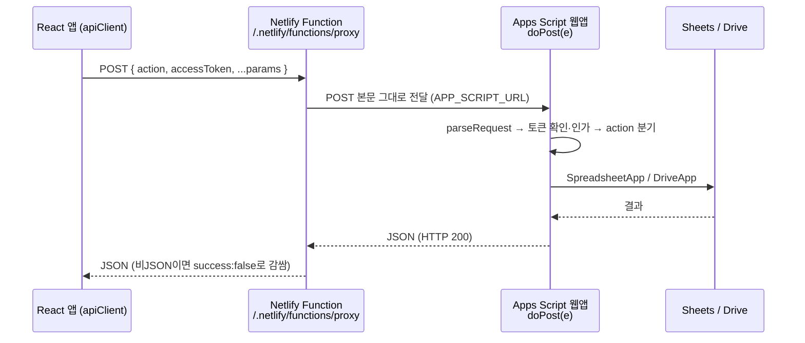

# HP ERP API 명세

> 개발 단계: **③ 설계 / ⑤ 구현** · 산출물: API 명세서
> 기준: `appScript/Main.gs`의 `doPost` 디스패치와 `appScript/Authz.gs` (2026-10-30, `main` @ `c2b8a6c`)

## 1. 호출 구조

백엔드는 Google Apps Script 웹앱 **하나**이고, 모든 기능은 `action` 필드로 구분합니다(RPC 방식).



| 환경 | 호출 주소 | 전달 방식 |
|---|---|---|
| 로컬 개발 | `/api` | Vite dev 서버 프록시 → `VITE_APP_SCRIPT_URL` |
| 배포 | `/.netlify/functions/proxy` | Netlify Function → 서버 전용 환경변수 `APP_SCRIPT_URL` |

프록시를 두는 이유는 Apps Script 웹앱이 CORS 헤더를 직접 제어하지 못하기 때문입니다. [ADR-004](./ADR.md#adr-004-apps-script-앞에-netlify-function-프록시를-둔다) 참고.

### 1.1 클라이언트 (`src/utils/api/apiClient.ts`)

- 본문: `{ action, accessToken, ...data }`를 JSON으로 `POST`. `accessToken`은 로그인한 사용자의 현재 Google 액세스 토큰이고, 로그인 전에는 빈 문자열입니다(§1.3)
- 시도마다 타임아웃 30초, 최대 2회 재시도(1s → 2s). 조회 액션만 재시도하고 쓰기 액션은 재시도하지 않습니다(429는 예외, `Retry-After` 준수). 4xx는 재시도하지 않습니다. 같은 조회가 진행 중이면 그 요청을 함께 씁니다. 상세는 [ARCHITECTURE.md §9.2](./ARCHITECTURE.md#92-데이터-로딩과-캐시)
- 조회 액션(`CACHEABLE_ACTIONS`)은 응답을 캐시하고, 쓰기 액션이 성공하면 관련 캐시를 무효화
- 설정값: `src/config/api.ts`

### 1.2 응답 형식

```jsonc
// 성공
{ "success": true, "data": { /* ... */ }, "message": "선택" }
// 실패 (Apps Script)
{ "success": false, "message": "오류 설명" }
// 실패 (Apps Script 인가, §1.3)
{ "success": false, "message": "로그인 확인이 필요한 요청입니다.", "code": "AUTH_REQUIRED" }
// 실패 (프록시: HTTP 400/405/500/502)
{ "success": false, "error": "오류 설명" }
// 실패 (프록시: HTTP 504. Apps Script가 약 9초 안에 응답하지 않음)
{ "success": false, "error": "Apps Script 응답 시간이 초과되었습니다.", "retryable": true }
```

- Apps Script는 오류가 나도 **항상 HTTP 200**을 반환합니다. 성공 여부는 반드시 `success`로 판단합니다.
- 일부 액션은 결과를 `data`가 아닌 필드로 돌려줍니다: `getAllUsers` → `users`, `getAnnouncements` → `announcements`, `checkUserStatus` → 최상위 `isRegistered / isApproved / approvalStatus`.
- 분기에 없는 액션: `{ success:false, message:"알 수 없는 액션입니다: …" }`
- `GET` 요청은 헬스체크, 설치 화면(`?page=setup`), 설치 진단(`?action=getSetupStatus&clientId=…`)에만 씁니다. 헬스체크 응답: `{ success:true, message:"Hot Potato App Script is running" }`

### 1.3 인가

Apps Script는 `doPost` 맨 앞에서 요청자를 확인합니다([ADR-015](./ADR.md#adr-015-apps-script가-액세스-토큰으로-요청자를-확인한다)).

1. `accessToken`을 Google tokeninfo로 확인합니다. `aud` 또는 `azp`가 스크립트 속성 `GOOGLE_CLIENT_ID`와 같고, `email_verified`이고, 만료 전이어야 합니다. 확인한 이메일은 5분 캐시합니다. 토큰은 저장하거나 로그에 남기지 않습니다.
2. 액션 종류에 따라 통과 여부를 정합니다.
3. 통과하면 `userEmail`을 확인한 이메일로, `userType`·`isAdmin`·`is_admin`을 `hp_member` 값으로 덮어씁니다. 브라우저가 보낸 값은 쓰지 않습니다.

| 종류 | 액션 | 조건 |
|---|---|---|
| 공개 | `getSetupStatus`, `login`, `checkUserStatus`, `checkApprovalStatus`, `registerUser`, `verifyAdminKey`, `encryptEmail`, `decryptEmail`, `decryptEmailBatch`, `validateStudentForEmployment`, `getEmploymentByStdNum`, `saveEmployment`, `getFieldList` (`Authz.gs`의 `PUBLIC_ACTIONS_`) | 없음 |
| 관리자 | `getAllUsers`, `getPendingUsers`, `approveUser`, `approveUserWithGroup`, `rejectUser`, `addUsersToSpreadsheet`, `clearUserCache`, `sendAdminKeyEmail`, `migrateEmails`, `uploadSharedTemplate`, `updateSharedTemplateMeta`, `deleteSharedTemplate`, `uploadSharedDocument`, `addStaticTag`, `updateStaticTag`, `deleteStaticTag`, `approvePinnedAnnouncement`, `getPinnedAnnouncementRequests`, `createWorkflowTemplate`, `updateWorkflowTemplate`, `deleteWorkflowTemplate`, 진단용 `test*` (`ADMIN_ACTIONS_`) | 승인된 회원이면서 관리자 |
| 회원 | 나머지 전부 | `hp_member`에서 승인된 회원 |

| `code` | 뜻 |
|---|---|
| `AUTH_REQUIRED` | 토큰이 없거나 확인에 실패함. `GOOGLE_CLIENT_ID`가 비었거나 사이트의 클라이언트 ID와 다를 때도 이 코드가 남 ([RUNBOOK.md RB-09](./RUNBOOK.md#rb-09-모든-기능이-로그인-확인이-필요한-요청입니다로-실패함)) |
| `MEMBER_REQUIRED` | 확인한 이메일이 승인된 회원이 아님 |
| `ADMIN_REQUIRED` | 관리자 액션인데 관리자가 아님 |

## 2. 액션 목록

권한 정책(역할별 접근, 관리자 전용 기능)은 [SECURITY.md](./SECURITY.md)에 정리했습니다.

### 2.1 회원 · 인증 · 관리자

| action | 필수 파라미터 | 설명 |
|---|---|---|
| `getSetupStatus` | (+`clientId`) | 공개. 설치 진단(`/setup`). `{success, installed, spreadsheetReady, serverClientIdConfigured, clientIdMatches, version}`. 보낸 `clientId`와 `GOOGLE_CLIENT_ID`의 일치 여부만 알려 주고 서버 값은 돌려주지 않음 |
| `checkUserStatus` | `email` | 가입·승인 상태 조회 |
| `checkApprovalStatus` | `email` | 위와 같은 데이터, `{data:{status,user}}` 형식 |
| `getUserNameByEmail` | `email` | 이메일 → 이름 |
| `registerUser` | `name, email, studentId` (+`userType, isAdmin, adminKey`) | 미리 등록된 학번·이름 행에 가입 정보 기록, 승인 대기(`X`) |
| `verifyAdminKey` | `adminKey` | 관리자 키 검증 |
| `getAllUsers` | — | 전체 사용자 + 대기/승인 분리 목록 |
| `getPendingUsers` | — | 승인 대기 목록 |
| `approveUserWithGroup` | `studentId, groupRole` | 승인(`O`) + Google 그룹 추가 시도, 실패 시 그룹 관리자에게 메일 |
| `rejectUser` | `studentId` | 가입 거부. 현재 `user` 시트에 `R`로 기록하고, 거부된 사용자는 다시 신청할 수 있음 |
| `addUsersToSpreadsheet` | `users:[{no_member,name_member}]` | 학번·이름 사전 등록 (중복 건너뜀) |
| `clearUserCache` | — | 사용자 캐시 삭제 |
| `sendAdminKeyEmail` | `userEmail` | 관리자 키 안내 메일 발송. 메일 발송에는 사용자 토큰을 쓰지 않음(토큰은 §1.3 신원 확인에만 씀) |

### 2.2 암호화

| action | 필수 파라미터 | 설명 |
|---|---|---|
| `encryptEmail` | `data` | 이메일·전화번호 암호화 |
| `decryptEmail` | `data` | 복호화 |
| `decryptEmailBatch` | `data[]` | 일괄 복호화 |

### 2.3 문서 · 양식 · 태그

| action | 필수 파라미터 | 설명 |
|---|---|---|
| `createDocument` | `title, creatorEmail` (+`templateType, editors[]`) | 빈 문서 생성 또는 양식 복사 → 권한 부여 → `shared_documents`로 이동. 파일 속성 `creatorEmail`에 만든 사람을 기록 |
| `getDocuments` | `role` (+`searchTerm, author, sortBy, page, limit`) | 공유 문서 목록, 페이지네이션 |
| `deleteDocuments` | `documentIds[]` (+`role`) | 공유 문서를 휴지통으로 이동. `shared_documents` 바로 아래 파일이면서 요청자(토큰으로 확인한 이메일)가 만든 사람(`creatorEmail` 속성, 없으면 설명의 생성자)인 파일만. 나머지는 `failures`로 돌려줌 |
| `uploadSharedDocument` | `fileName, fileContentBase64, meta` | 관리자. 파일 업로드(Office → Google 형식 변환) |
| `getTemplates` | — | `shared_forms` 양식 목록 |
| `getSharedTemplates` | — | 공유 양식 + 메타데이터 |
| `uploadSharedTemplate` | `fileName, fileContentBase64, meta` | 공유 양식 업로드 (약 12MB 이하) |
| `updateSharedTemplateMeta` | `fileId, meta, editorEmail` | 양식 메타 수정 |
| `deleteSharedTemplate` | `fileId, userEmail` | 양식 삭제 |
| `getStaticTags` | — | 공용 태그 목록 |
| `addStaticTag` | `tag, userEmail` | 태그 추가 |
| `updateStaticTag` | `oldTag, newTag, userEmail` (+`confirm`) | `confirm` 없으면 영향받는 양식만 반환, 있으면 실제 수정 |
| `deleteStaticTag` | `tag, userEmail` (+`confirm, deleteTemplates`) | 2단계 삭제 |
| `exportTemplateFile` | `templateId` | 공유 양식을 Office 형식으로 내보냄(Google 문서 → docx, 스프레드시트 → xlsx). 응답 `data: {name, sourceMimeType, exportMimeType, fileData(base64)}`. `shared_forms` 바로 아래 파일만 허용. 브라우저가 받은 파일을 Google 형식으로 변환해 사용자 개인 폴더에 올림(나만 보기 문서, 장부 Excel 내보내기). 배포자가 `script.external_request`를 승인해야 동작 |
| `getTemplateSheetPreview` | `templateId` (+`sheetName`) | 공유 스프레드시트 양식의 시트 목록과, `sheetName`을 주면 그 시트의 값·표시값·병합 범위(최대 1000행)를 돌려줌. 장부 내보내기 미리보기용. `shared_forms` 바로 아래 파일만 허용 |
| `getSpreadsheetIds` | `spreadsheetNames[]` | 스프레드시트 이름 → ID. 응답 `{success:true, data:{이름: ID 또는 null}, notFound?:[못 찾은 이름]}`. 이름 배열이 비면 `success:false`. 루트 폴더 아래 파일만 찾고, 이름으로 찾은 시스템 스프레드시트는 배포 계정 소유일 때만 씁니다. 문자열이 아닌 이름은 버리고, Drive 검색 1회 + 서버 캐시 6시간으로 찾습니다([ADR-013](./ADR.md#adr-013-스프레드시트-id를-drive-검색-1회와-서버-캐시로-찾는다)). 클라이언트는 `notFound`가 있거나 `null`이 섞인 응답을 캐시하지 않음 |

### 2.4 공지사항

공통 파라미터: `spreadsheetId` 또는 `spreadsheetName`

| action | 필수 파라미터 | 설명 |
|---|---|---|
| `getAnnouncements` | `userId, userType` | 공개 범위로 거른 뒤 고정 공지를 먼저 정렬 |
| `uploadNoticeAttachment` | `fileName, fileData(base64), mimeType` | 승인 회원만. 첨부 파일을 `notice/attached_file/`에 저장하고 `data: {id, name, url}` 반환. 서버에서 4MB 이하, 허용 형식(문서·스프레드시트·PDF·이미지·zip·hwp)만 받음. 파일은 공지를 등록·수정할 때 공개 범위 대상에게 보기 권한으로 공유되고, 링크 공개로 두지 않음 |
| `createAnnouncement` | `writerEmail, title, content` (+`accessRights, fileNotice, isPinned`) | 공지 작성, 본문 이미지는 Drive 업로드 후 URL로 치환 |
| `updateAnnouncement` | `announcementId, userId` | 수정. 본문 이미지를 서버가 올리고, 첨부 공유 대상을 바뀐 공개 범위에 맞춤 |
| `deleteAnnouncement` | `announcementId, userId` | 삭제 |
| `incrementAnnouncementView` | `announcementId` | 조회수 +1 |
| `requestPinnedAnnouncement` | `announcementId, userId` | 고정 요청 (`fix_notice='-'`) |
| `approvePinnedAnnouncement` | `announcementId, approvalAction` | 고정 승인(`O`) / 반려(`X`) |
| `getPinnedAnnouncementRequests` | — | 고정 요청 대기 목록 |
| `getAnnouncementUserList` | — | 공개 범위 선택용 사용자 목록 |

### 2.5 결재(워크플로우)

| action | 필수 파라미터 | 설명 |
|---|---|---|
| `requestWorkflow` | `requesterEmail, reviewLine[], paymentLine[]` + 문서 정보 | 결재 등록, 결재선 참여자에게 열람 권한 부여 |
| `grantWorkflowPermissions` | `documentId, userEmails[]` | 문서 권한 부여 |
| `getWorkflowStatus` | `workflowId` 또는 `documentId` | 단건 조회 |
| `getMyPendingWorkflows` | `userEmail` (+`lineType, status`) | 내가 처리할 결재 |
| `getMyRequestedWorkflows` | `userEmail` | 내가 올린 결재 |
| `getCompletedWorkflows` | `userEmail` (+기간) | 완료·반려된 결재 |
| `approveReview` / `rejectReview` / `holdReview` | `workflowId, userEmail` (+`opinion, rejectReason, holdReason`) | 검토 단계 처리 |
| `approvePayment` / `rejectPayment` / `holdPayment` | 위와 같음 | 결재 단계 처리 (검토 전원 승인 후) |
| `resubmitWorkflow` | `workflowId, userEmail` (+결재선·내용 수정) | 반려 건 재상신 |
| `getWorkflowHistory` | `workflowId` | 처리 이력 |
| `createWorkflowTemplate` | `creatorEmail, templateName, reviewLine, paymentLine` | 결재선 템플릿 생성 |
| `getWorkflowTemplates` | — | 템플릿 목록 |
| `updateWorkflowTemplate` | `templateId, userEmail` | 템플릿 수정 |
| `deleteWorkflowTemplate` | `templateId, userEmail` | 템플릿 삭제 |

결재 상태 전이는 [ARCHITECTURE.md의 상태 다이어그램](./ARCHITECTURE.md#6-상태-다이어그램)을 참고하세요.

### 2.6 회계

장부 **데이터**(입출금, 예산계획)는 프론트가 Sheets API로 직접 읽고 씁니다. Apps Script는 장부 구조 생성과 권한 설정, 증빙 업로드와 장부 목록을 맡습니다.

| action | 필수 파라미터 | 설명 |
|---|---|---|
| `createLedger` | `ledgerName, accountName, creatorEmail, mainManagerEmail` (+`initialBalance, accessUsers[], accessGroups[], subManagerEmails[]`) | 장부 폴더, 스프레드시트, 증빙 폴더 생성 + 공유 |
| `getLedgerList` | — | 장부 목록. 요청자가 접근 대상(만든 사람, 주·부관리인, 접근 사용자, `access_group_emails`의 역할 그룹 구성원)인 장부만 반환. 장부 정보 화면과 대시보드 장부 위젯도 이 액션을 씀 |
| `uploadEvidenceFile` | `spreadsheetId, evidenceFolderId, fileName, fileData(base64)` (+`mimeType`) | 승인 회원 중 그 장부의 접근 대상만. `evidenceFolderId`가 그 장부의 증빙 폴더(회계 폴더 아래)여야 함. 서버에서 4MB 이하만 받음(형식 제한은 없음). 응답 `data: {fileId, fileName}` |
| `updateAccountSubManagers` | `spreadsheetId, accountId, subManagerEmails[]` | 부관리인 변경 |
| `getAccountingFolderId` | — | `account/` 폴더 ID (없으면 생성) |
| `getAccountingCategories` | `spreadsheetId` | 카테고리 목록 |

### 2.7 학생 · 학년 · 취업

| action | 필수 파라미터 | 설명 |
|---|---|---|
| `getStudentRetainedStatus` / `updateStudentRetained` | `studentId, spreadsheetId` (+`isRetained`) | 유급 조회·변경 |
| `getGraduationGrade` / `setGraduationGrade` | `spreadsheetId` (+`grade, userEmail`) | 졸업 학년 조회·설정 |
| `updateStudentGrades` | `spreadsheetId` (+졸업 연도·학기) | 전체 학생 진급·졸업 처리 |
| `updateStudentGradesSelected` | `spreadsheetId, studentIds[]` | 선택 학생만 진급 |
| `setGraduatedAdvanced` | `spreadsheetId, graduatedStudentIds[]` | 졸업생 진학 여부 반영 |
| `validateStudentForEmployment` | `std_num, name, phone` | 로그인 없이 본인 확인 (취업 정보 입력용) |
| `getEmploymentByStdNum` | `std_num` | 취업 정보 조회 |
| `saveEmployment` / `updateEmploymentAfter` | `std_num`, 취업 정보 | 취업 정보 저장·수정 |
| `getFieldList` | — | 직종 분야 목록 |
| `createField` / `updateField` / `deleteField` | `field_num, userEmail` (+`field_name`) | 직종 분야 관리 |

### 2.8 진단용

운영 환경에서는 쓰지 않는 점검용 액션입니다. 모두 관리자 액션입니다.

| action | 설명 |
|---|---|
| `testDriveApi` | Drive API 연결 확인 |
| `testSpecificFolder` | 특정 폴더 접근 확인 |
| `testTemplateFolderDebug` | 양식 폴더 탐색 디버그 |

### 2.9 Apps Script 액션이 없는 기능

| 기능 | 처리 방식 |
|---|---|
| 캘린더, 학생·교직원 목록, 학생 이슈, 장부 데이터, 개인 설정 | 프론트가 Sheets API로 직접 처리 (`src/utils/database/*`). 자체 모듈 `src/utils/google/sheetsClient.ts`를 씀 |
| 초기 세팅 (`initializeSystem`, `installSystem`) | 편집기에서 수동 실행하거나, 설치 화면(`?page=setup`)에서 설치 토큰으로 실행 ([DEPLOYMENT.md](./DEPLOYMENT.md)) |
| 역할 폴더 공유 재적용 (`applyRoleFolderSharing`), 장부 권한 재부여 (`applyLedgerSharing`), 공지 첨부 권한 재적용 (`applyNoticeAttachmentSharing`), 예산계획 열 이전 (`migrateBudgetPlanColumns`), 설치 토큰 생성 (`createSetupToken`) | Apps Script 편집기에서 수동 실행 |
| 관리자 키 일일 갱신 (`handleDailyKeyUpdate`) | 시간 기반 트리거 |

## 3. 정리가 필요한 부분

| 항목 | 내용 |
|---|---|
| 프론트에만 남은 액션 | `getAccountingCategorySummary`, `getPendingBudgetPlans`, `setWorkflowLine`, `migrateEmails`, `requestPinnedAnnouncementApproval`, `testEmailEncryption`, `testAllAppScript`는 백엔드 분기가 없어 "알 수 없는 액션"을 받습니다 |
| 중복 분기 | `Main.gs`에 결재 관련 분기가 두 번 있고, 두 번째 블록은 도달하지 않았습니다. 2026-10-30 운영 반영분에서 제거 |
| 응답 형식 | 결과 필드 이름이 액션마다 달라 프론트에 분기 코드가 생깁니다. `{success, data, message}`로 통일하는 것이 목표입니다 |
| `CONFIG.gs`의 `SUPPORTED_ACTIONS` | 실제 디스패치와 맞지 않는 오래된 목록입니다 |
