# HP ERP 아키텍처

> 개발 단계: **④ 구조 생성**(Component·Deployment) · **③ 설계**(Sequence·Class) · **⑤ 구현**(State) · **⑥ 테스트**(Communication) · **⑦ 문서화**(Package)
> 기준: `main` 브랜치 코드 (2026-10-27)

설계 결정의 **이유**는 [ADR.md](./ADR.md)에, 데이터 구조는 [DATA_MODEL.md](./DATA_MODEL.md)에 있습니다. 이 문서는 시스템이 **어떻게 생겼고 어떻게 움직이는지**를 다룹니다.

## 1. 시스템 개요

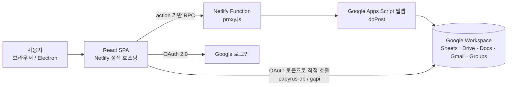

| 계층 | 기술 | 역할 |
|---|---|---|
| 클라이언트 | React 19, TypeScript, Vite 5, Zustand, Tiptap, Recharts | 화면, 상태, 캐시 |
| 데스크톱 셸 (선택) | Electron 38 | 같은 번들을 데스크톱 앱으로 실행 |
| 프록시 | Netlify Functions | CORS 처리, Apps Script URL 은닉 |
| 백엔드 | Google Apps Script (V8) | 회원·공지·결재·문서 처리, Drive 권한 조작 |
| 저장소 | Google Sheets, Google Drive | 데이터(시트), 파일(Drive) |
| 인증 | Google OAuth 2.0 | 로그인, Sheets·Drive·Calendar 직접 접근 토큰 |

## 2. Component 다이어그램

모듈 경계와 의존 방향입니다. 프론트엔드에서 백엔드로 가는 길은 **apiClient(Apps Script 경유)**와 **papyrusManager(Sheets 직접)** 두 가지입니다.

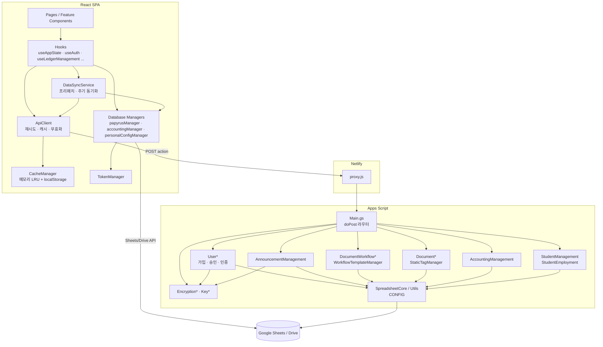

## 3. Deployment 다이어그램

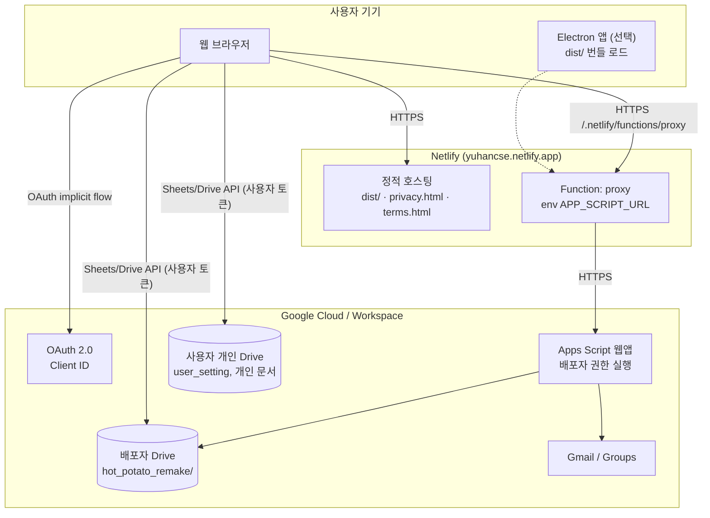

| 노드 | 배포 방식 | 설정 |
|---|---|---|
| Netlify 정적 호스팅 | `main` 푸시 시 Netlify가 `npm run build` 후 `dist/` 게시 | `netlify.toml` |
| Netlify Function | 같은 빌드에 포함 (`netlify/functions/`) | 대시보드 환경변수 `APP_SCRIPT_URL` |
| Apps Script | `clasp push` 후 기존 웹앱 배포의 버전 교체 | `appScript/appsscript.json`, 스크립트 속성 |
| Electron | 로컬에서 `npm run electron:build` | `package.json`의 `build` 항목 |

절차는 [DEPLOYMENT.md](./DEPLOYMENT.md)를 참고하세요.

## 4. Sequence 다이어그램

### 4.1 로그인 → 가입 → 승인 → 첫 진입

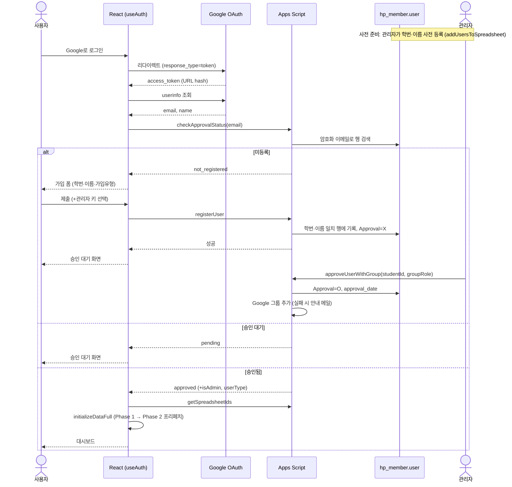

### 4.2 결재 요청과 처리

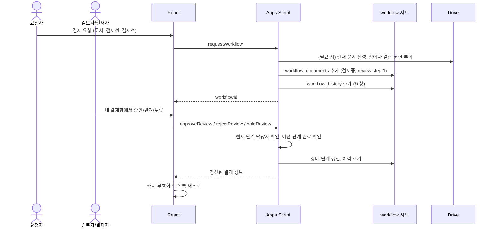

## 5. Class 다이어그램 (프론트엔드 핵심 타입)

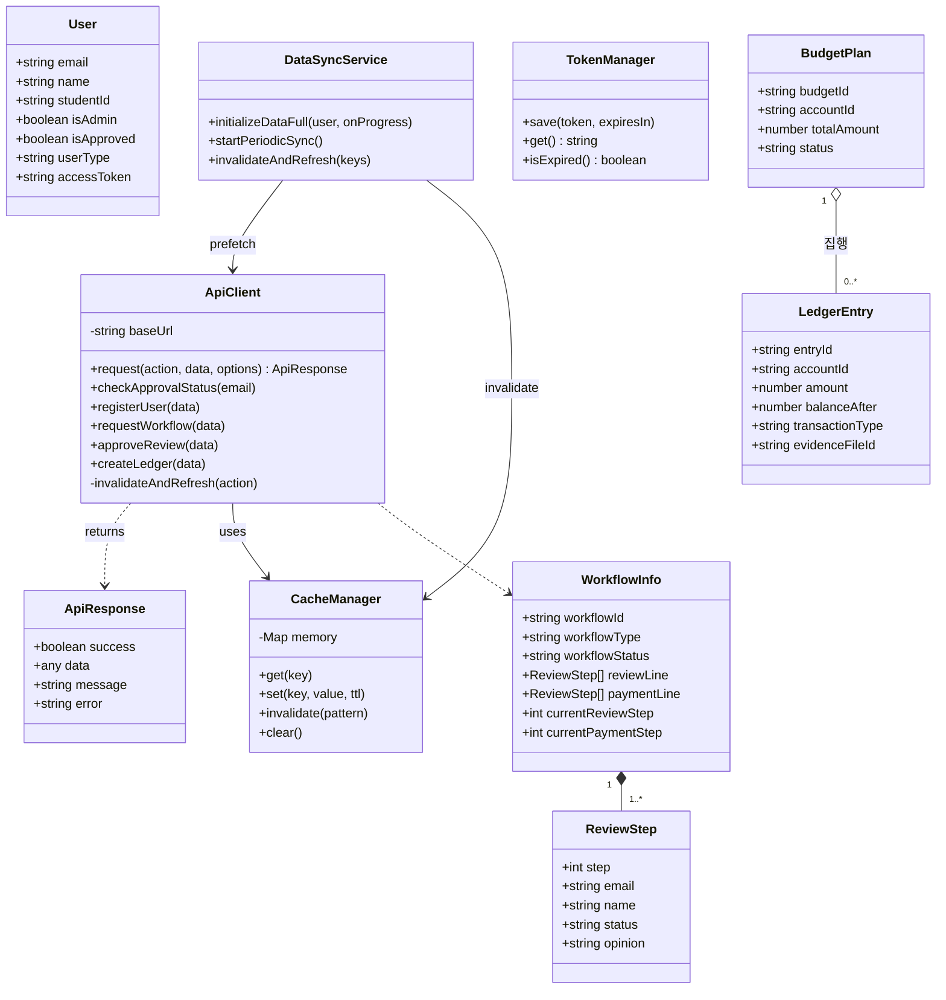

## 6. 상태 다이어그램

### 6.1 회원 승인

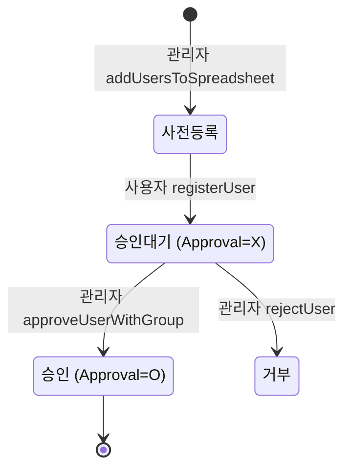

`checkUserStatus`는 사전등록 상태도 `not_registered`로 돌려줍니다. 사용자 입장에서는 "가입 폼이 뜨는 상태"입니다.

### 6.2 결재 (`workflow_documents.workflow_status`)

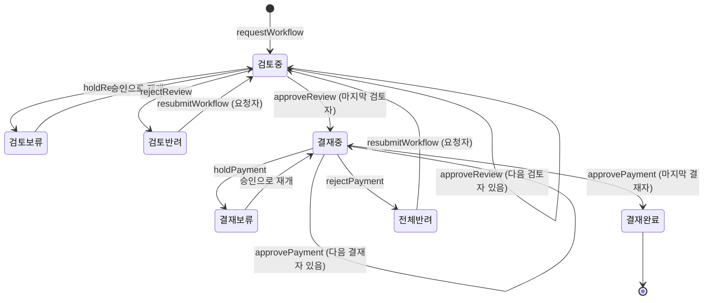

- 결재선의 각 단계는 `대기 → 승인 | 반려 | 보류`이며, 보류 단계는 승인(재개)만 할 수 있습니다.
- 검토 단계가 **모두 승인**되어야 결재 단계로 넘어갑니다.
- 모든 전이는 `workflow_history`에 한 줄씩 남습니다.

### 6.3 예산 계획 (`예산계획.status`)

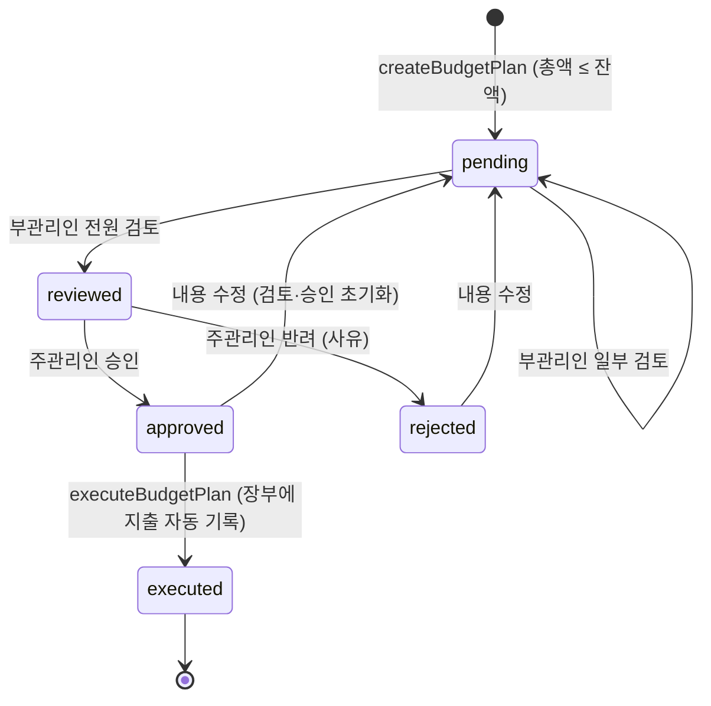

### 6.4 공지 고정 (`notice.fix_notice`)

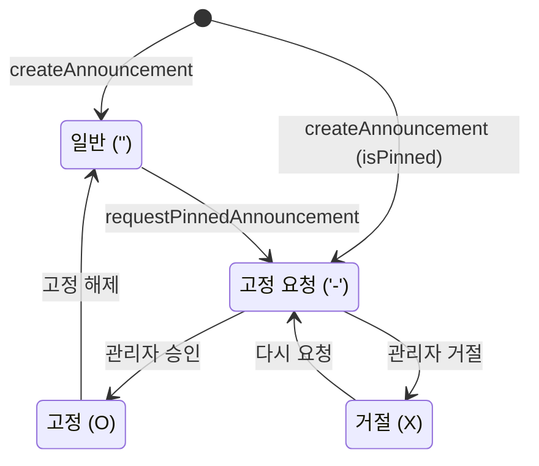

## 7. Communication 다이어그램 (결재 승인)

테스트 단계에서 객체 사이의 메시지 순서를 점검할 때 쓰는 그림입니다. 번호는 메시지 순서입니다.

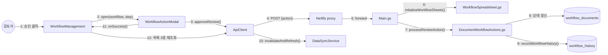

## 8. Package 다이어그램

### 8.1 프론트엔드 (`src/`)

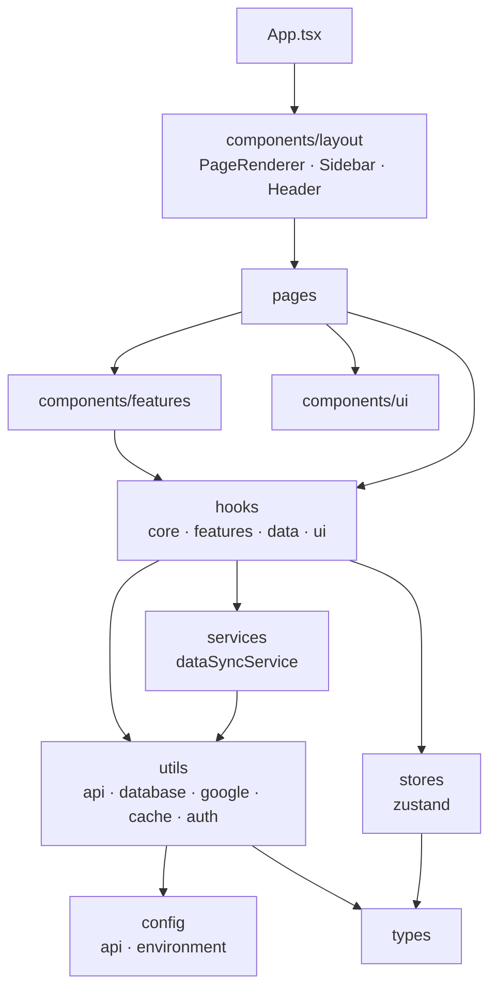

| 폴더 | 책임 |
|---|---|
| `pages/` | 화면 단위 컨테이너, `React.lazy`로 지연 로딩 |
| `components/layout/` | 앱 셸. `PageRenderer`가 `currentPage`에 따라 페이지를 고름 |
| `components/features/<도메인>/` | accounting, admin, auth, calendar, dashboard, documents, staff, students, templates, timetable, workflow |
| `components/ui/` | 공통 UI (ErrorBoundary, OfflineBanner, LoadingProgress, TiptapEditor, VirtualList 등) |
| `hooks/core/` | `useAppState`: 사용자, 현재 페이지, 스프레드시트 ID, 공용 데이터 |
| `hooks/features/` | 도메인 로직 (`useAuth`, `useLedgerManagement`, `useWidgetManagement` …) |
| `services/` | `dataSyncService`: 로그인 후 프리페치, 주기 동기화, 쓰기 후 무효화 |
| `utils/api/` | `apiClient`: Apps Script 호출 |
| `utils/database/` | Sheets 직접 접근 (`papyrusManager`, `accountingManager`, `personal*Manager`) |
| `utils/cache/` | 2단계 캐시 |
| `config/` | API 설정, 환경변수(`ENV_CONFIG`) 파싱 |

정리할 의존성: `dataSyncService ↔ papyrusManager` 순환 참조, `utils → components/hooks` 역방향 참조 몇 건이 있습니다 ([STATUS.md](./STATUS.md#4-기술-백로그)).

### 8.2 Apps Script (`appScript/`)

Apps Script는 모든 파일이 **전역 스코프 하나**를 공유합니다. 아래 화살표는 "다른 파일에 정의된 전역 함수를 호출한다"는 뜻입니다.

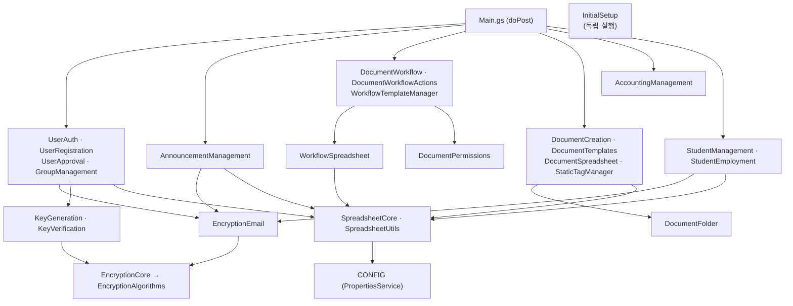

## 9. 프론트엔드 동작 방식

### 9.1 화면 전환

- 라우터 라이브러리 없이 `currentPage` 상태와 `?page=` 쿼리로 화면을 바꿉니다 (`useAppState.ts`, `App.tsx`).
- 진입 순서: 인증 확인 → 미로그인이면 `Login` → 미승인이면 `PendingApproval` → 앱 셸(`Sidebar` + `PageRenderer`).
- 메뉴 노출은 역할에 따라 달라집니다. 회계는 `std_council`·`professor`·`supp`, 관리자 메뉴는 `is_admin`, 학년 관리는 `supp`만 봅니다.

### 9.2 데이터 로딩과 캐시

Apps Script는 응답이 느리고 호출 할당량이 있어서, **호출 수를 줄이는 것**을 프론트엔드 설계의 기준으로 삼았습니다.

| 단계 | 내용 | 위치 |
|---|---|---|
| 1. 스프레드시트 ID 해석 | 이름 목록을 한 번에 보내 ID를 받음 | `papyrusManager.initializeSpreadsheetIds` |
| 2. Phase 1 프리페치 | 공지, 캘린더, 템플릿, 태그, 결재 템플릿, 장부 목록을 **동시 8개씩** 가져옴 | `dataSyncService.initializeDataFull` |
| 3. Phase 2 프리페치 | 문서, 학생, 교직원, 내 결재, (관리자) 사용자 목록을 화면을 막지 않고 가져옴 | 같은 파일 |
| 4. 화면 표시 | 각 화면이 같은 API를 다시 부르면 **캐시 적중** | `apiClient`, `cacheManager` |
| 5. 주기 동기화 | 카테고리별 간격으로 캐시만 갱신, 탭이 비활성이면 멈춤 | `dataSyncService` |
| 6. 쓰기 후 | 관련 캐시 키 무효화 후 재조회 (800ms 디바운스) | `apiClient.invalidateAndRefresh` |

| 데이터 | 캐시 TTL | 주기 동기화 |
|---|---|---|
| 결재 | 3분 | 5분 |
| 회계 | 5분 | 10분 |
| 공지·문서 | 10분 | 15분 |
| 캘린더 | 15분 | 15분 |
| 사용자·템플릿·학생 | 30분 | 30분 |
| 스프레드시트 ID·장부 목록 | 45분 | 60분 |

- 캐시 저장소: 메모리 `Map`(LRU 100개) + `localStorage`(`cache_*`, 항목 100KB 미만, 전체 5MB)
- 429(호출 초과) 응답이 오면 해당 카테고리 동기화를 30~120분 쉽니다.
- 오프라인이면 `OfflineBanner`를 띄우고, TTL 안의 캐시로 일부 화면을 보여 줍니다.
