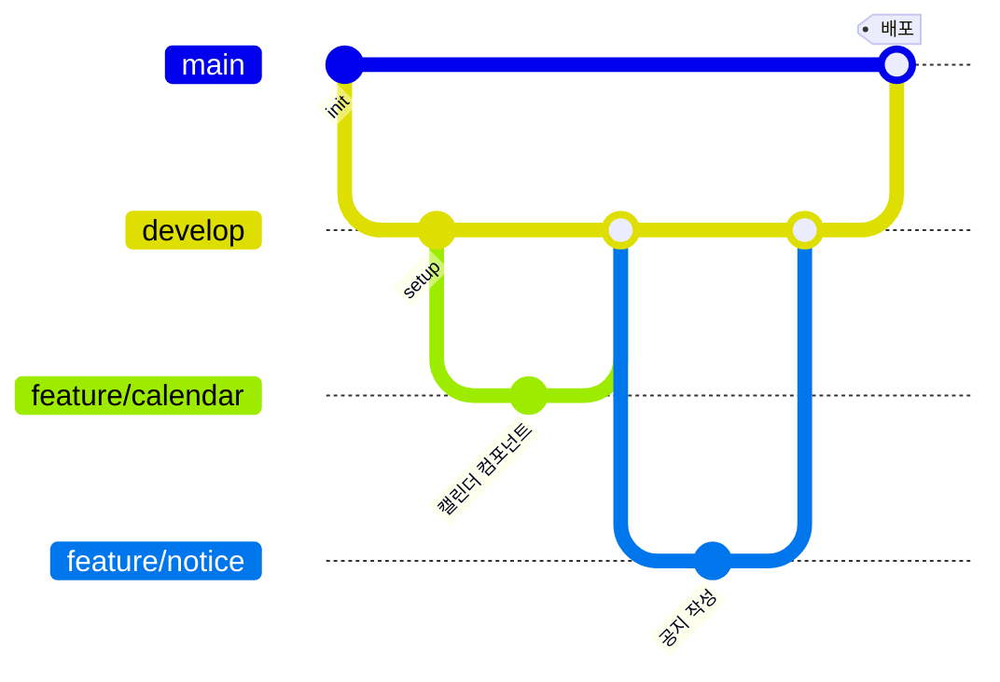

# HP ERP 코딩 규칙과 협업 가이드

> 개발 단계: **④ 구조 생성** · 산출물: 코딩 규칙, 협업 가이드(브랜치 전략)

**규칙** 열은 앞으로 지킬 기준이고, **현재** 열은 코드가 실제로 어떤 상태인지입니다. 둘이 다른 항목은 [STATUS.md](./STATUS.md#4-기술-백로그)에서 정리합니다.

## 1. 브랜치 전략

원본 프로젝트(2025.07~12)부터 Git Flow를 단순화한 방식을 썼습니다.

| 브랜치 | 용도 | 규칙 |
|---|---|---|
| `main` | 배포 브랜치. 푸시하면 Netlify가 자동 배포 | 직접 커밋하지 않고 `develop`에서 병합 |
| `develop` | 통합 브랜치 | 기능 브랜치를 병합해 동작 확인 |
| `feature/<기능>` | 기능 개발 | 예: `feature/calendar`, `feature/notice`, `feature/admin`, `feature/spreadsheetRoot` |
| `fix/<이슈>` | 버그 수정 | 예: `fix/Notice`, `fix/studentInfoNotUploading` |

리메이크 후반에는 `main`에 직접 커밋한 경우가 있습니다. 2명 이상이 함께 작업할 때는 위 규칙으로 돌아갑니다.

## 2. 커밋 메시지

- 한국어로 **무엇을 왜** 바꿨는지 한 줄로 씁니다. 예: `관리자 키 인증 절차 픽스`, `장부 증빙폴더 환경변수화`
- 한 커밋에는 한 가지 목적만 담습니다.
- `.`, `수정`처럼 내용을 알 수 없는 메시지는 쓰지 않습니다.

## 3. TypeScript / React

| 항목 | 규칙 | 현재 |
|---|---|---|
| 컴포넌트·페이지 파일 | PascalCase `.tsx`, 같은 이름의 `.css`를 옆에 둠 (`Login.tsx` + `Login.css`) | 준수 |
| 훅 | `useXxx.ts` (JSX를 반환하면 `.tsx`) | 준수 |
| 유틸 | camelCase, 역할을 접미사로 (`xxxManager.ts`, `xxxUtils.ts`) | 준수 |
| 도메인 코드 위치 | `components/features/<도메인>`, `hooks/features/<도메인>` | 준수 |
| 의존 방향 | `pages → components → hooks → services/stores → utils → config/types` (역방향 금지) | 일부 위반 ([ARCHITECTURE §8.1](./ARCHITECTURE.md#81-프론트엔드-src)) |
| Apps Script 호출 | `apiClient.request(action, data)`만 사용. `fetch` 직접 호출 금지 | 준수 |
| Sheets 직접 접근 | `utils/database/*` 매니저를 통해서만 | 대부분 준수 |
| 환경 의존 값 | `ENV_CONFIG`(`src/config/environment.ts`)에서 읽음. 폴더·시트 이름 하드코딩 금지 | 준수 (ENV V2 전환 완료) |
| 타입 | `any` 금지, 새 코드는 타입을 명시 | `any` 경고 97건 |
| 파일 머리 주석 | `@file` / `@brief` / `@details` JSDoc | TS/TSX 196개 중 92개 |
| 로그 | 운영 코드의 `console.log`는 최소화 | 디버그 로그 다수 |

### 포맷과 린트

| 도구 | 설정 | 명령 |
|---|---|---|
| Prettier | `.prettierrc`: 작은따옴표, 세미콜론, `trailingComma: es5`, 80자, 2칸 들여쓰기, `endOfLine: lf` | `npm run format`, `npm run format:check` |
| ESLint 9 | `eslint.config.js`: `@eslint/js` + `typescript-eslint` + `react-hooks` + `react-refresh` 권장 규칙 | `npm run lint` |
| TypeScript | `tsconfig.app.json` | `npx tsc --noEmit -p tsconfig.app.json` |

> `npm run type-check`(`tsc --noEmit`)는 루트 `tsconfig.json`이 참조(`references`)만 갖고 있어 실제 파일을 검사하지 않습니다. 타입 검사는 위의 `-p tsconfig.app.json` 명령을 쓰세요.

## 4. Apps Script

| 항목 | 규칙 |
|---|---|
| 파일 이름 | 도메인 PascalCase (`UserAuth.gs`, `AccountingManagement.gs`) |
| 함수 이름 | camelCase. 파일 내부 헬퍼는 `_` 접미사 (`flattenCreateLedgerRequest_`) |
| 새 액션 추가 | `Main.gs`의 `doPost`에 분기 추가 → 도메인 파일에 핸들러 → 프론트 `apiClient` 메서드 → [API_SPEC.md](./API_SPEC.md) 갱신 |
| 응답 형식 | `{ success, data, message }` |
| 전역 이름 | Apps Script는 모든 파일이 전역 스코프를 공유합니다. **같은 이름의 함수를 두 파일에 만들지 않습니다** |
| 설정값 | 폴더·시트 이름은 스크립트 속성(`CONFIG.gs` getter)에서 읽음 |
| 개인정보 | 이메일·전화번호는 `encryptEmailMain`으로 암호화해서 저장 |

## 5. 문서

- 기능이나 API를 바꾸면 같은 커밋에서 관련 문서(`API_SPEC`, `DATA_MODEL`, `STATUS`)도 고칩니다.
- 구현 상태는 [STATUS.md](./STATUS.md) **한 곳**에서만 관리합니다. 다른 문서에는 상태를 적지 않고 링크합니다.
- 다이어그램은 Mermaid로 문서 안에 둡니다. 이미지로 따로 만들지 않습니다.
