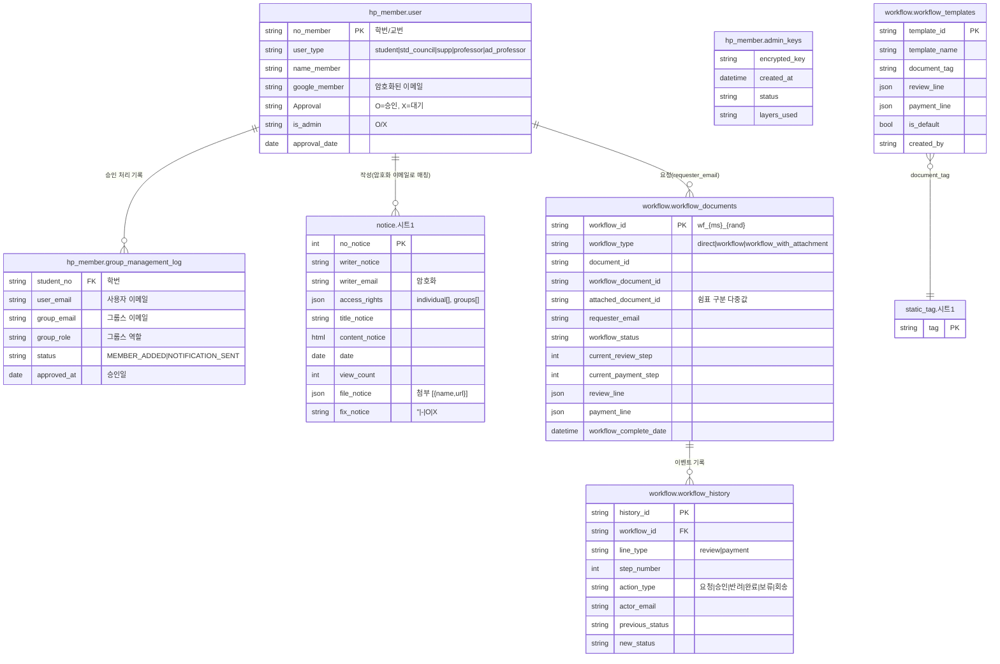
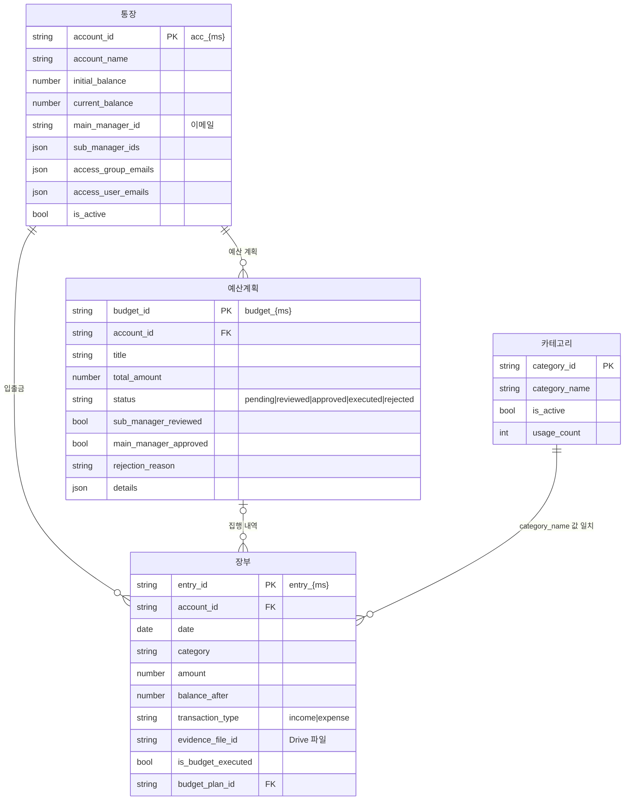
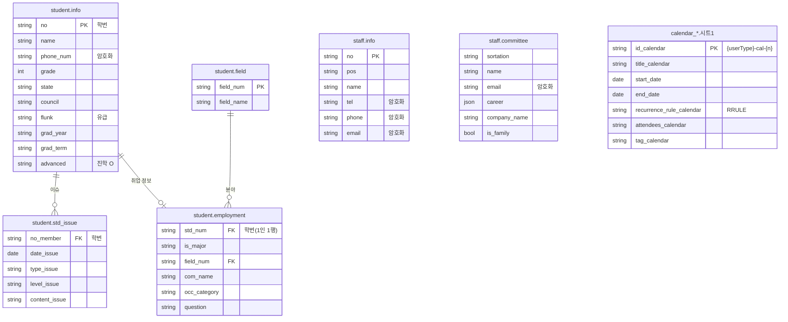

# HP ERP 데이터 모델 (ERD)

> 개발 단계: **③ 설계** · 산출물: ERD, 데이터 저장 구조
> 기준: `main` 브랜치 코드 (2026-10-27)

이 시스템은 별도 DB 서버 없이 **Google Sheets를 데이터베이스로** 사용합니다.
스프레드시트 파일 하나가 "DB", 그 안의 시트(탭) 하나가 "테이블"이고, 1행이 레코드입니다.
파일은 Google Drive 폴더 트리에 놓이고, 프론트엔드는 파일 **이름**으로 ID를 찾아 접근합니다.

## 1. 저장소 한눈에 보기

| 스프레드시트 | Drive 위치 | 만드는 쪽 | 읽고 쓰는 쪽 | 내용 |
|---|---|---|---|---|
| `hp_member` | `ROOT/` | 초기 세팅(GAS) | Apps Script 전용 | 회원, 관리자 키, 그룹 처리 로그 |
| `notice` | `ROOT/notice/` | 초기 세팅 | Apps Script | 공지사항 |
| `workflow` | `ROOT/workflow/` | 초기 세팅 | Apps Script | 결재 문서, 결재 이력, 결재선 템플릿 |
| `static_tag` | `ROOT/document/` | 초기 세팅 | Apps Script | 공용 문서 태그 |
| `calendar_*` (5종) | 역할별 폴더 | 초기 세팅 | 프론트 직접(papyrus-db) | 역할별 일정 |
| `student` | `ROOT/std_council/` | 초기 세팅 | 프론트 직접 + GAS | 학생 정보, 이슈, 취업 |
| `staff` | `ROOT/assistant/` | 초기 세팅 | 프론트 직접 | 교직원, 위원회 |
| `{장부명}_장부` | `ROOT/account/{장부명}/` | GAS `createLedger` | 생성은 GAS, 데이터는 프론트 직접 | 통장, 장부, 예산계획, 카테고리 |
| `user_setting` | **각 사용자 개인 드라이브** | 프론트 | 프론트 직접 | 즐겨찾기, 개인 태그, 시간표, 대시보드 위젯 |

데이터 접근 경로는 두 가지입니다. 이유는 [ADR-003](./ADR.md#adr-003-데이터-접근-경로를-두-갈래로-나눈다)에 있습니다.

1. **Apps Script 경유** — 회원·공지·결재·문서처럼 권한 검사나 Drive 조작이 필요한 데이터
2. **브라우저에서 Sheets API 직접 호출** — 캘린더·학생·교직원·장부 데이터처럼 조회가 잦고 Drive 공유 권한으로 접근을 통제할 수 있는 데이터

## 2. ERD

Sheets에는 FK 제약이 없으므로, 아래 관계는 **값이 일치하는 열**을 뜻합니다. 무결성은 애플리케이션 코드가 지킵니다.

### 2.1 회원 · 공지 · 결재



`group_management_log`의 실제 헤더는 한글입니다: `학번, 사용자 이메일, 사용자 이름, 그룹스 이메일, 그룹스 이름, 그룹스 역할, 상태, 승인일`. ERD 문법상 영문 이름으로 적었습니다.

### 2.2 회계 장부 (장부 1개 = 스프레드시트 1개)



### 2.3 학생 · 교직원 · 개인 설정



`user_setting`(사용자 개인 드라이브)은 다른 엔터티와 관계가 없는 독립 저장소입니다.

| 시트 | 열 | 용도 |
|---|---|---|
| `favorite` | `type, favorite` | 템플릿 즐겨찾기 (`type` = 기본/개인) |
| `tag` | `tag` | 개인 태그 |
| `schedule` | `no, title, date, start_time, end_time, description, color` | 개인 시간표 |
| `dashboard` | `widget_id, widget_type, widget_order, widget_config` | 대시보드 위젯 배치 |

## 3. 시트를 쓰지 않는 메타데이터

일부 정보는 시트 대신 **Drive 파일 속성(`properties`)**에 저장합니다.

| 대상 | 속성 | 근거 |
|---|---|---|
| 공유 양식 (`document/shared_forms`) | `description, tag, creatorEmail, createdDate` | `appScript/DocumentTemplates.gs` |
| 공유 문서 (`document/shared_documents`) | `creator, creatorEmail, createdDate, tag` | `appScript/DocumentCreation.gs` |
| 개인 양식 (`document/personal_forms`) | `tag` | `appScript/StaticTagManager.gs` |

태그 이름을 바꾸거나 지우면 `static_tag` 시트와 해당 파일들의 `properties.tag`를 함께 갱신합니다.

## 4. Drive 폴더 구조

### 4.1 조직 공용 폴더 (Apps Script 배포자 드라이브)

`initializeSystem()`(`appScript/InitialSetup.gs`)이 만듭니다. 공유 드라이브(Shared Drive)가 아니라 **배포자의 내 드라이브**에 생성됩니다.

```text
hot_potato_remake/                 ← ROOT (스크립트 속성 ROOT_FOLDER_ID)
├── hp_member
├── notice/
│   ├── notice
│   └── attached_file/             ← 공지 첨부, 본문 이미지
├── account/
│   └── {장부명}/                   ← createLedger 시 생성
│       ├── {장부명}_장부
│       └── evidence/              ← 증빙 파일
├── workflow/
│   ├── workflow
│   └── (결재용으로 생성된 Google Docs)
├── document/
│   ├── static_tag
│   ├── shared_documents/
│   └── shared_forms/
├── professor/      └── calendar_professor
├── student/        └── calendar_student
├── std_council/    ├── calendar_council
│                   └── student
├── adj_professor/  └── calendar_adj_professor
└── assistant/      ├── calendar_assistant
                    └── staff
```

### 4.2 사용자 개인 폴더 (각 사용자 드라이브)

```text
hot_potato_remake/
├── user_setting
└── document/
    ├── personal_documents/
    └── personal_forms/
```

## 5. 식별자 · 저장 규칙

- **ID 생성:** `{접두어}_{epoch ms}[_{rand}]` 형식입니다 (`wf_`, `hist_`, `tpl_`, `acc_`, `entry_`, `budget_`). 공지 번호만 기존 최대값 + 1입니다.
- **개인정보 암호화:** 회원 이메일, 공지 작성자 이메일, 학생 연락처, 교직원 연락처·이메일은 암호화해서 저장합니다. 방식과 한계는 [SECURITY.md](./SECURITY.md)에 정리했습니다.
- **JSON 열:** 결재선(`review_line`, `payment_line`), 공지 공개 범위(`access_rights`), 첨부(`file_notice`), 통장 권한 목록은 JSON 문자열로 저장합니다.
- **스프레드시트 ID 해석:** 프론트가 `getSpreadsheetIds` 액션에 이름 배열을 보내면, Apps Script가 ROOT 하위를 재귀 탐색해 **이름이 일치하는 첫 파일**의 ID를 돌려줍니다. 이름이 같은 파일이 둘 이상이면 첫 번째만 씁니다.

## 6. 알려진 불일치 (정리 대상)

코드를 기준으로 문서를 쓰면서 발견한 항목입니다. 수정 계획은 [STATUS.md](./STATUS.md)의 백로그에서 관리합니다.

| 항목 | 내용 | 위치 |
|---|---|---|
| 예산계획 열 순서 | GAS 헤더(15열), 프론트 쓰기(16열), 프론트 읽기 인덱스가 서로 다릅니다 | `AccountingManagement.gs`, `src/utils/database/accountingBudgetManager.ts` |
| `admin_keys_backup` 헤더 | 초기 세팅 헤더와 실제 백업 코드가 쓰는 열 순서가 다릅니다 | `InitialSetup.gs`, `KeyGeneration.gs` |
| 카테고리 조회 | `getAccountingCategories`가 `카테고리` 시트가 아니라 첫 시트를 읽습니다 | `AccountingManagement.gs` |
| 레거시 문서 시트 | `학생_문서관리` 등은 더 이상 생성되지 않지만 일부 조회·삭제 코드가 참조합니다 | `CONFIG.gs`, `DocumentSpreadsheet.gs` |
| `workflow/attached_file/` | 폴더는 만들지만 사용하는 코드가 없습니다 | `InitialSetup.gs` |
