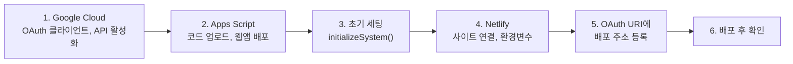

# HP ERP 배포 가이드

> 개발 단계: **④ 구조 생성 / ⑤ 구현** · 산출물: 인프라 구성, 빌드·배포 절차
> 대상: 새 환경을 처음부터 세팅하거나, 운영 중인 서비스에 변경을 배포하는 사람
> 구성도는 [ARCHITECTURE.md §3 Deployment](./ARCHITECTURE.md#3-deployment-다이어그램)를 보세요.

## 0. 전체 순서



처음 세팅할 때만 1~6을 모두 합니다. 이후 변경 배포는 [§7](#7-변경-배포)만 보면 됩니다.

## 1. Google Cloud Console

1. [Google Cloud Console](https://console.cloud.google.com/)에서 프로젝트를 만듭니다.
2. **API 및 서비스 → OAuth 동의 화면**: 외부(또는 조직 내부) 유형, 앱 이름·지원 이메일을 입력합니다.
3. **사용자 인증 정보 → OAuth 클라이언트 ID**: 유형은 **웹 애플리케이션**입니다.
   - 승인된 JavaScript 원본과 리디렉션 URI에 같은 값을 넣습니다: `http://localhost:5173`, `http://localhost:8888`, 배포 주소(5단계에서 추가)
4. **라이브러리**에서 아래 API를 사용 설정합니다: Google Sheets API, Google Drive API, Google Docs API, Google Calendar API

앱이 요청하는 OAuth 범위: `spreadsheets`, `drive`, `documents`, `calendar.events`, `calendar.readonly`, `gmail.compose`, `profile`, `email`

## 2. Apps Script

### 2.1 프로젝트 만들기와 코드 업로드

[clasp](https://github.com/google/clasp)으로 `appScript/` 폴더를 올립니다.

```bash
npm i -g @google/clasp
clasp login
# https://script.google.com/home/usersettings 에서 Apps Script API 사용 설정
clasp create --type webapp --title "HP ERP Backend" --rootDir appScript
# 또는 기존 프로젝트에 연결: 루트에 .clasp.json 생성
#   { "scriptId": "<스크립트 ID>", "rootDir": "appScript" }
clasp push
```

- `.clasp.json`은 `.gitignore`에 들어 있습니다. 각자 만들어야 합니다.
- `appScript/appsscript.json`(매니페스트)도 함께 올라갑니다. 고급 서비스 8종(Drive, DriveActivity, Gmail, Calendar, Docs, Sheets, AdminGroupsSettings, AdminDirectory)이 여기 정의되어 있습니다.

### 2.2 웹앱 배포

1. 편집기에서 **배포 → 새 배포 → 웹 앱**을 고릅니다.
2. 실행 사용자와 액세스 권한은 매니페스트(`appsscript.json`의 `webapp`) 설정을 따릅니다.
3. 배포 후 나오는 **웹 앱 URL**(`.../exec`)을 복사해 둡니다. 4단계에서 씁니다.
4. 첫 실행 때 권한 승인 창이 뜨면 배포 계정으로 승인합니다.

> 이후 코드를 바꿀 때는 **새 배포를 만들지 말고** "배포 관리 → 기존 배포 편집 → 새 버전"으로 올립니다. 새 배포를 만들면 URL이 바뀌어 Netlify 환경변수도 바꿔야 합니다.

## 3. 초기 세팅 (Drive 폴더·시트 생성)

1. Apps Script 편집기에서 `InitialSetup.gs`를 열고 `initializeSystem`을 실행합니다.
2. 배포 계정의 내 드라이브에 `hot_potato_remake/` 폴더 트리와 스프레드시트 11개가 생깁니다. 구조는 [DATA_MODEL.md §4](./DATA_MODEL.md#4-drive-폴더-구조)에 있습니다.
3. 스크립트 속성(`ROOT_FOLDER_ID`, `SPREADSHEET_ID`, 폴더·시트 이름 등)이 자동으로 채워집니다. 이미 있는 값은 덮어쓰지 않습니다.
4. **실행 로그를 꼭 확인합니다.** 개별 폴더·시트 생성이 실패해도 결과가 `success:true`로 나올 수 있습니다.
5. 관리자 키 일일 갱신 트리거를 만듭니다: **트리거 → 트리거 추가 → `handleDailyKeyUpdate`, 시간 기반, 일 단위**. 트리거를 만들지 않으면 관리자 키가 생성되지 않습니다.
6. (Workspace 사용 시) 역할별 Google 그룹 이메일을 스크립트 속성 `GROUP_EMAIL_JSON`에 넣습니다.

이후 사용자 사전 등록과 첫 관리자 만들기는 [OPERATOR_MANUAL.md](./OPERATOR_MANUAL.md)를 따릅니다.

## 4. Netlify

1. Netlify에서 **Add new site → Import an existing project**로 GitHub 저장소를 연결합니다. 배포 브랜치는 `main`입니다.
2. 빌드 설정은 `netlify.toml`을 따릅니다.

   | 항목 | 값 |
   |---|---|
   | Build command | `npm run build` |
   | Publish directory | `dist` |
   | Functions | `netlify/functions` |
   | Node | 18 (`NODE_VERSION`) |

3. **Site configuration → Environment variables**에 아래 값을 넣습니다.

   | 변수 | 필수 | 쓰는 곳 |
   |---|---|---|
   | `APP_SCRIPT_URL` | ✅ | **Netlify Function(프록시)이 읽는 유일한 값**. 없으면 모든 API가 500 |
   | `VITE_GOOGLE_CLIENT_ID` | ✅ | 빌드 시 번들에 포함 |
   | `VITE_APP_SCRIPT_URL` | 권장 | 빌드 시 환경 검증용 |
   | `VITE_FOLER_NAME`, `VITE_SPREADSHEET_NAME`, `VITE_SHEET_NAME`, `VITE_GROUP_EMAIL` | 기본값을 바꿀 때 | 빌드 시 번들에 포함 |

   > `VITE_*` 값은 빌드할 때 번들에 들어가므로 **공개 값**입니다. 비밀 값을 `VITE_`로 시작하는 이름에 넣지 마세요.
   > 환경변수를 바꾼 뒤에는 **Deploys → Trigger deploy → Clear cache and deploy site**로 다시 빌드해야 반영됩니다.

4. 리다이렉트는 `netlify.toml`에 정의되어 있습니다: `/privacy` → `/privacy.html`, `/terms` → `/terms.html`, 그 외 → `/index.html`(SPA)

## 5. OAuth에 배포 주소 등록

Google Cloud Console의 OAuth 클라이언트에서 **승인된 JavaScript 원본**과 **승인된 리디렉션 URI**에 배포 주소(예: `https://yuhancse.netlify.app`)를 추가합니다. 원본과 리디렉션 URI에는 끝에 `/`를 붙이지 않은 같은 주소를 넣습니다.

## 6. 배포 후 확인

- [ ] 사이트 접속 시 로그인 화면이 뜬다
- [ ] `/privacy`, `/terms` 페이지가 열린다
- [ ] Google 로그인 후 앱으로 돌아온다 (`redirect_uri_mismatch`가 없다)
- [ ] 승인 대기 또는 대시보드 화면이 뜬다
- [ ] 개발자 도구 Network 탭에서 `/.netlify/functions/proxy` 응답이 `200`이고 본문이 `success:true`다
- [ ] 공지사항과 캘린더 데이터가 보인다

문제가 생기면 [RUNBOOK.md](./RUNBOOK.md)를 보세요.

## 7. 변경 배포

| 바꾼 것 | 배포 방법 |
|---|---|
| 프론트엔드 (`src/`, `public/`) | `main`에 병합 → Netlify 자동 빌드·배포 |
| 프록시 (`netlify/functions/`) | 위와 같음 |
| Apps Script (`appScript/`) | `clasp push` → 편집기 **배포 관리 → 기존 배포 편집 → 새 버전** (URL 유지) |
| 환경변수 | Netlify 대시보드에서 수정 → Clear cache and deploy |
| 스크립트 속성 | Apps Script **프로젝트 설정 → 스크립트 속성** |

**백엔드를 먼저, 프론트엔드를 나중에** 배포합니다. 새 액션을 쓰는 프론트가 먼저 나가면 "알 수 없는 액션" 오류가 납니다.

### 롤백

| 대상 | 방법 |
|---|---|
| Netlify | **Deploys**에서 이전 배포를 골라 **Publish deploy** |
| Apps Script | **배포 관리 → 기존 배포 편집**에서 이전 버전 선택 |

## 8. Electron (선택)

```bash
npm run electron:build   # 웹 빌드 후 electron-builder 실행 → dist-electron/
```

- 산출물: Windows NSIS, macOS dmg, Linux AppImage (`package.json`의 `build` 항목)
- 패키징된 앱은 `file://`로 열리기 때문에 OAuth 리디렉션과 API 경로가 웹과 다르게 동작합니다. 현재 공식 배포 채널은 웹입니다([ADR-011](./ADR.md#adr-011-electron은-같은-번들을-감싸는-선택-배포로-둔다)).

## 9. CI 현황

현재 GitHub Actions는 없습니다(2026-02-26 삭제, [ADR-012](./ADR.md#adr-012-ci를-걷어내고-netlify-빌드를-배포-게이트로-쓴다)). 자동 검사는 Netlify 빌드 성공 여부 하나입니다. 병합 전에 로컬에서 아래 명령을 돌립니다.

```bash
npm run build && npm test && npm run lint
```
