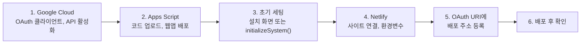

# HP ERP 배포 가이드

> 개발 단계: **④ 구조 생성 / ⑤ 구현** · 산출물: 인프라 구성, 빌드·배포 절차
> 대상: 새 환경을 처음부터 세팅하거나, 운영 중인 서비스에 변경을 배포하는 사람
> 구성도는 [ARCHITECTURE.md §3 Deployment](./ARCHITECTURE.md#3-deployment-다이어그램)를 보세요.

## 0. 전체 순서



처음 세팅할 때만 1~6을 모두 합니다. 이후 변경 배포는 [§7](#7-변경-배포)만 보면 됩니다.

### 개발 지식이 없는 담당자의 새 설치

운영 중인 설치 안내 사이트의 `/install/`을 열어 0~14단계를 순서대로 진행합니다. 마법사에서 사이트 이름을 먼저 정하고 Google OAuth 원본을 만든 뒤, `VITE_APP_SCRIPT_URL`, `VITE_GOOGLE_CLIENT_ID`, `VITE_GROUP_EMAIL`을 Netlify 첫 배포에 한 번에 넣습니다. 실제 Netlify 주소가 예정 주소와 다르면 Google Cloud의 승인된 JavaScript 원본과 리디렉션 URI를 실제 주소로 바꿔야 합니다.

설치 안내 사이트 자체를 배포하는 운영자는 별도 설치용 OAuth 웹 클라이언트 ID를 `VITE_INSTALL_CLIENT_ID`에 넣습니다. 환경변수를 쓰지 않는 정적 호스팅은 `public/install/config.js`의 `googleClientId`에 넣을 수 있습니다. 이 값이 없으면 `/install/`은 경고를 표시하고 자동 백엔드 생성을 안전하게 막습니다. 운영 앱용 `VITE_GOOGLE_CLIENT_ID`와 혼동하지 마세요.

## 1. Google Cloud Console

1. [Google Cloud Console](https://console.cloud.google.com/)에서 프로젝트를 만듭니다.
2. **API 및 서비스 → OAuth 동의 화면**: 외부(또는 조직 내부) 유형, 앱 이름·지원 이메일을 입력합니다.
3. **사용자 인증 정보 → OAuth 클라이언트 ID**: 유형은 **웹 애플리케이션**입니다.
   - 승인된 JavaScript 원본과 리디렉션 URI에 같은 값을 넣습니다: `http://localhost:5173`, `http://localhost:8888`, 배포 주소(5단계에서 추가)
4. **라이브러리**에서 아래 API를 사용 설정합니다: Google Sheets API, Google Drive API, Google Docs API, Google Calendar API

앱이 요청하는 OAuth 범위: `drive.file`, `spreadsheets`, `calendar.events`, `calendar.readonly`, `profile`, `email`

- 이 클라이언트 ID는 Netlify `VITE_GOOGLE_CLIENT_ID`와 Apps Script 스크립트 속성 `GOOGLE_CLIENT_ID`에 **같은 값**으로 넣습니다. Apps Script는 이 값으로 요청자의 토큰을 확인하므로, 다르면 로그인한 모든 요청이 거부됩니다([ADR-015](./ADR.md#adr-015-apps-script가-액세스-토큰으로-요청자를-확인한다)).
- 운영 클라이언트는 2026-10-30에 운영 계정 소유 프로젝트의 `651515712118-…`로 바꿨습니다. `drive.file`은 파일을 만든 앱 기준이라, 클라이언트를 바꾸면 사용자가 이전 클라이언트로 만든 개인 파일(개인 설정 등)은 보이지 않고 새로 만들어집니다.
- `drive.file`로는 이 앱이 만든 파일만 보입니다. 배포자 소유 공유 파일을 다루는 일은 Apps Script가 대신합니다. 범위별 이유와 인증 절차는 [OAUTH_PUBLISHING.md](./OAUTH_PUBLISHING.md)에 있습니다.

## 2. Apps Script

### 2.1 프로젝트 만들기와 코드 업로드

[clasp](https://github.com/google/clasp)으로 `appScript/` 폴더를 올립니다.

```bash
npm i -g @google/clasp
clasp login
# https://script.google.com/home/usersettings 에서 Apps Script API 사용 설정
clasp create --type webapp --title "HP ERP Backend" --rootDir appScript
# 또는 기존 프로젝트에 연결: 루트에 .clasp.json 생성
#   { "scriptId": "<스크립트 ID>", "rootDir": "appScript", "fileExtension": "gs" }
clasp push --force
```

- `.clasp.json`은 `.gitignore`에 들어 있습니다. 각자 만들어야 합니다. `rootDir`이 `appScript`가 아니면 저장소 전체가 올라가니 꼭 확인합니다.
- `clasp push`는 Apps Script 프로젝트의 **HEAD 코드**를 통째로 바꿉니다. 편집기에서만 고친 코드가 있으면 덮어써지므로, 먼저 `clasp pull`을 다른 폴더에서 받아 백업하고 저장소와 비교합니다. `--force`는 매니페스트 변경 확인 질문을 건너뜁니다.
- 명령은 clasp 3.x 기준입니다.
- `appScript/appsscript.json`(매니페스트)도 함께 올라갑니다. 고급 서비스 8종(Drive, DriveActivity, Gmail, Calendar, Docs, Sheets, AdminGroupsSettings, AdminDirectory)이 여기 정의되어 있습니다.
- 스크립트는 스프레드시트에 붙이지 않은 **독립형(standalone)** 프로젝트로 만듭니다. `hp_member`를 포함한 폴더·시트는 `initializeSystem`이 만듭니다.

### 2.2 웹앱 배포

1. 편집기에서 **배포 → 새 배포 → 웹 앱**을 고릅니다.
2. 실행 사용자와 액세스 권한은 매니페스트(`appsscript.json`의 `webapp`) 설정을 따릅니다.
3. 배포 후 나오는 **웹 앱 URL**(`.../exec`)을 복사해 둡니다. 4단계에서 씁니다.
4. 첫 실행 때 권한 승인 창이 뜨면 배포 계정으로 승인합니다. 양식 내보내기(`exportTemplateFile`)와 요청자 토큰 확인(tokeninfo)이 `UrlFetchApp`을 쓰므로 `script.external_request`("외부 서비스에 연결")도 승인해야 합니다. 편집기에서 아무 함수나 한 번 실행하면 승인 창이 뜹니다.

> **배포 계정의 앱 권한을 지우지 마세요.** [myaccount.google.com/permissions](https://myaccount.google.com/permissions)에서 이 Apps Script 프로젝트의 권한을 삭제하면 그 계정으로 실행되는 **모든 웹앱 배포가 403(액세스 거부됨)**을 돌려줍니다. 편집기에서 아무 함수나 실행해 다시 승인할 때까지 계속됩니다.

> 이후 코드를 바꿀 때는 **새 배포를 만들지 말고** "배포 관리 → 기존 배포 편집 → 새 버전"으로 올립니다. 새 배포를 만들면 URL이 바뀌어 Netlify 환경변수도 바꿔야 합니다.

### 2.3 테스트 배포로 먼저 확인하기

운영 배포는 **고정 버전**을 가리키므로, `clasp push`로 HEAD를 바꿔도 운영 사이트에는 영향이 없습니다. 바뀐 백엔드는 별도 테스트 배포를 만들어 확인합니다.

```bash
clasp push --force
clasp create-deployment -d "test: <브랜치 이름>"
clasp list-deployments   # 새 배포 ID 확인
```

1. 새 배포의 웹앱 URL(`https://script.google.com/macros/s/<배포 ID>/exec`)을 로컬 `.env`의 `VITE_APP_SCRIPT_URL`에 넣고 `npm run dev:web`을 다시 시작합니다.
2. 운영 배포는 그대로 둡니다. 확인이 끝나면 운영 배포를 **기존 배포 편집 → 새 버전**으로 올립니다(§7).
3. `@HEAD` 배포(`.../dev` URL)는 쓰지 않습니다. 로그인된 브라우저에서만 열리기 때문에 Vite 프록시를 통한 호출은 실패합니다.
4. 매니페스트의 고급 서비스(특히 AdminDirectory)가 바뀌면 편집기에서 함수를 한 번 실행해 권한을 다시 승인해야 할 수 있습니다.
5. 다 쓴 테스트 배포는 **배포 관리**에서 보관 처리합니다.

2026-10-30 기준으로 운영 배포(배포 ID `AKfycbxTkbSb…`)는 @59(고정 버전, `main` @ `c2b8a6c`와 같은 코드)입니다. 직전 운영 버전은 @34입니다.

## 3. 초기 세팅 (Drive 폴더·시트 생성)

새로 설치할 때는 설치 화면을 쓰는 것이 간단합니다. 설치 화면은 1회용 설치 토큰으로 보호됩니다.

1. 편집기에서 `createSetupToken`을 실행합니다. 처음 실행이면 권한 승인 창이 뜨고, 이 승인이 웹앱 실행에 필요한 최초 승인도 겸합니다. 실행 로그에 `SETUP_TOKEN`이 찍힙니다.
2. 웹앱 주소 뒤에 `?page=setup`을 붙여 설치 화면(`SetupPage.html`)을 엽니다. 루트 폴더 이름, Google OAuth 클라이언트 ID(§1), 첫 관리자 이메일, 역할별 그룹 주소, 설치 토큰을 넣습니다.
3. 설치가 끝나면 `GOOGLE_CLIENT_ID`, `GROUP_EMAIL_JSON`, `ROOT_FOLDER_NAME`이 저장되고, 아래 2~6과 같은 초기화와 첫 관리자 등록이 실행됩니다. `SETUP_DONE`이 `true`가 되고 `SETUP_TOKEN`은 지워집니다.
4. 아래 8(관리자 키 트리거)은 직접 합니다.

`/install/` 마법사로 Apps Script 프로젝트를 만든 경우에도 7~8단계가 같은 순서를 안내합니다. 이미 `SPREADSHEET_ID`가 있고 `SETUP_TOKEN`이 없는 기존 설치는 설치된 것으로 보고, 설치 화면과 `createSetupToken`이 거부합니다.

편집기에서 직접 세팅할 때:

1. **그룹 주소부터 정합니다.** 역할별 Google 그룹 주소는 기관마다 다릅니다. 기본값과 다르면 `initializeSystem`을 실행하기 **전에** 스크립트 속성 `GROUP_EMAIL_JSON`에 한 줄 JSON으로 넣습니다. 키는 `STUDENT`, `COUNCIL`, `PROFESSOR`, `ADJ_PROFESSOR`, `ASSISTANT`입니다. 기본값은 `student_hp`, `std_council_hp`, `professor_hp`, `adj_professor_hp`, `assistant_hp`(모두 `@googlegroups.com`)입니다. 프론트 `VITE_GROUP_EMAIL`(§4)도 같은 값으로 맞춥니다.
2. Apps Script 편집기에서 `InitialSetup.gs`를 열고 `initializeSystem`을 실행합니다.
3. 배포 계정의 내 드라이브에 `hot_potato_remake/` 폴더 트리와 `hp_member`를 포함한 스프레드시트 11개가 생깁니다. 구조는 [DATA_MODEL.md §4](./DATA_MODEL.md#4-drive-폴더-구조)에 있습니다.
4. 스크립트 속성(폴더·시트 이름 등)이 자동으로 채워집니다. 이미 있는 값은 덮어쓰지 않습니다(`GROUP_EMAIL_JSON` 포함). `ROOT_FOLDER_ID`와 `SPREADSHEET_ID`만은 이번 실행에서 실제로 쓴 루트 폴더와 `hp_member`로 **항상 다시 씁니다**. 마지막에 스프레드시트 ID 캐시도 비웁니다(`clearSpreadsheetIdCache()`).
5. 마지막 단계에서 역할 폴더를 Google 그룹에 편집 권한으로 공유합니다(아래 표). 이미 있는 권한은 건너뛰므로 다시 실행해도 됩니다. 실행 결과의 `sharing`에서 `no_group_email`이나 `failed`가 없는지 봅니다.
6. **실행 로그를 꼭 확인합니다.** 개별 폴더·시트 생성이 실패해도 결과가 `success:true`로 나올 수 있습니다.
7. 편집기로 세팅했다면 스크립트 속성 `GOOGLE_CLIENT_ID`에 OAuth 클라이언트 ID(§1)를 직접 넣습니다. 편집기에서 실행한 `initializeSystem`은 이 값을 채우지 않습니다.
8. 관리자 키 일일 갱신 트리거를 만듭니다: **트리거 → 트리거 추가 → `handleDailyKeyUpdate`, 시간 기반, 일 단위**. 트리거를 만들지 않으면 관리자 키가 생성되지 않습니다.

역할 폴더 공유 (학생 < 학생회 < 조교 ≈ 겸임교원 ≈ 교수):

| 폴더 | 편집 권한을 받는 그룹 |
|---|---|
| `student/` | 학생, 학생회, 조교, 겸임교원, 교수 |
| `std_council/` | 학생회, 조교, 겸임교원, 교수 |
| `assistant/`, `adj_professor/`, `professor/` | 조교, 겸임교원, 교수 |

- 공통 폴더(`notice`, `workflow`, `document`, `account`)와 `hp_member`, 각 사용자의 `user_setting`은 그룹에 공유하지 않습니다. 이 파일들은 Apps Script를 거치거나 파일 단위 공유로 접근합니다. 공지 첨부는 공지 공개 범위 대상에게 파일 단위로 공유됩니다.
- 역할 폴더는 브라우저가 Sheets API로 직접 쓰기 때문에 일부러 편집 권한으로 공유합니다.
- 이미 설치된 환경에는 편집기에서 `applyRoleFolderSharing`을 실행하면 이 공유만 적용하고 결과를 로그에 출력합니다. 기존 장부의 권한은 `applyLedgerSharing`으로 다시 부여합니다([OPERATOR_MANUAL.md §6](./OPERATOR_MANUAL.md#6-회계-장부)).

이후 사용자 사전 등록과 첫 관리자 만들기는 [OPERATOR_MANUAL.md](./OPERATOR_MANUAL.md)를 따릅니다.

## 4. Netlify

1. Netlify에서 **Add new site → Import an existing project**로 GitHub 저장소를 연결합니다. 배포 브랜치는 `main`입니다.
2. 빌드 설정은 `netlify.toml`을 따릅니다.

   | 항목 | 값 |
   |---|---|
   | Build command | `npm run build` |
   | Publish directory | `dist` |
   | Functions | `netlify/functions` |
   | Node | 18 (`NODE_VERSION`) |

3. **Site configuration → Environment variables**에 아래 값을 넣습니다.

   | 변수 | 필수 | 쓰는 곳 |
   |---|---|---|
   | `APP_SCRIPT_URL` | ✅ | Netlify Function(프록시)이 읽는 값. 없으면 `VITE_APP_SCRIPT_URL`을 쓰고, 둘 다 없으면 모든 API가 500 |
   | `VITE_GOOGLE_CLIENT_ID` | ✅ | 빌드 시 번들에 포함. Apps Script `GOOGLE_CLIENT_ID`와 같은 값 |
   | `VITE_APP_SCRIPT_URL` | 권장 | 빌드 시 환경 검증용. `APP_SCRIPT_URL`이 없을 때 프록시의 대체값 |
   | `VITE_FOLER_NAME`, `VITE_SPREADSHEET_NAME`, `VITE_SHEET_NAME`, `VITE_GROUP_EMAIL` | 기본값을 바꿀 때만 | 빌드 시 번들에 포함. **한 줄 JSON**으로 넣거나, 기본값을 쓸 거면 아예 만들지 않음 |

   > JSON 변수는 `.env.example`처럼 여러 줄로 붙여 넣으면 Netlify에는 첫 줄 `{`만 저장됩니다. 이 경우 파싱이 **경고 없이** 실패하고 `src/config/environment.ts`의 기본값이 쓰입니다. 2026-10-29에 운영 사이트의 네 값이 모두 `{`인 것을 확인했습니다. 예: `VITE_GROUP_EMAIL` = `{"STUDENT":"student_hp@googlegroups.com","PROFESSOR":"professor_hp@googlegroups.com","COUNCIL":"std_council_hp@googlegroups.com","ADJ_PROFESSOR":"adj_professor_hp@googlegroups.com","ASSISTANT":"assistant_hp@googlegroups.com"}`. 이 값은 스크립트 속성 `GROUP_EMAIL_JSON`과 같아야 합니다.

   > 개인 폴더 이름은 `VITE_FOLER_NAME`의 `PERSONAL` 키로 바꿀 수 있습니다. 기본값은 `hot_potato_personal`이고, 공유 루트 `hot_potato_remake`와 다른 폴더입니다.

   > `VITE_*` 값은 빌드할 때 번들에 들어가므로 **공개 값**입니다. 비밀 값을 `VITE_`로 시작하는 이름에 넣지 마세요.
   > 환경변수를 바꾼 뒤에는 **Deploys → Trigger deploy → Clear cache and deploy site**로 다시 빌드해야 반영됩니다.

4. 리다이렉트는 `netlify.toml`에 정의되어 있습니다: `/privacy` → `/privacy.html`, `/terms` → `/terms.html`, 그 외 → `/index.html`(SPA)

## 5. OAuth에 배포 주소 등록

Google Cloud Console의 OAuth 클라이언트에서 **승인된 JavaScript 원본**과 **승인된 리디렉션 URI**에 배포 주소(예: `https://yuhancse.netlify.app`)를 추가합니다. 원본과 리디렉션 URI에는 끝에 `/`를 붙이지 않은 같은 주소를 넣습니다.

## 6. 배포 후 확인

- [ ] 사이트 접속 시 로그인 화면이 뜬다
- [ ] `/privacy`, `/terms` 페이지가 열린다
- [ ] Google 로그인 후 앱으로 돌아온다 (`redirect_uri_mismatch`가 없다)
- [ ] 승인 대기 또는 대시보드 화면이 뜬다
- [ ] 개발자 도구 Network 탭에서 `/.netlify/functions/proxy` 응답이 `200`이고 본문이 `success:true`다
- [ ] 공지사항과 캘린더 데이터가 보인다
- [ ] `/setup`에서 "서버·사이트 클라이언트 ID 일치"가 일치로 나온다. 아니면 로그인한 모든 요청이 `AUTH_REQUIRED`로 실패한다([RUNBOOK.md RB-09](./RUNBOOK.md#rb-09-모든-기능이-로그인-확인이-필요한-요청입니다로-실패함))

문제가 생기면 [RUNBOOK.md](./RUNBOOK.md)를 보세요.

## 7. 변경 배포

| 바꾼 것 | 배포 방법 |
|---|---|
| 프론트엔드 (`src/`, `public/`) | `main`에 병합 → Netlify 자동 빌드·배포 |
| 프록시 (`netlify/functions/`) | 위와 같음 |
| Apps Script (`appScript/`) | `clasp push --force` → 테스트 배포로 확인(§2.3) → 편집기 **배포 관리 → 기존 배포 편집 → 새 버전** (URL 유지) |
| 스프레드시트 파일 교체·이동·이름 변경 | Apps Script 편집기에서 `clearSpreadsheetIdCache()` 실행 ([OPERATOR_MANUAL.md §7](./OPERATOR_MANUAL.md#7-데이터-직접-수정-시-주의)) |
| 환경변수 | Netlify 대시보드에서 수정 → Clear cache and deploy |
| 스크립트 속성 | Apps Script **프로젝트 설정 → 스크립트 속성** |
| OAuth 범위·Apps Script 권한 | 프론트 범위가 바뀌면 사용자가 다시 동의합니다. Apps Script가 새 서비스를 쓰면 편집기에서 아무 함수나 실행해 배포 계정으로 다시 승인합니다 |

**백엔드를 먼저, 프론트엔드를 나중에** 배포합니다. 새 액션을 쓰는 프론트가 먼저 나가면 "알 수 없는 액션" 오류가 납니다.

### 운영 반영 체크리스트

2026-10-30에 develop을 main(`c2b8a6c`)에 병합하고 Apps Script 운영 배포를 @34에서 @59로 올릴 때 쓴 순서입니다. 다음 운영 반영에도 같은 순서를 씁니다.

1. 병합할 `develop` 코드를 테스트 배포(§2.3)와 로컬 개발 서버에서 먼저 확인합니다.
2. Netlify 환경변수를 확인합니다. `APP_SCRIPT_URL`(또는 `VITE_APP_SCRIPT_URL`)이 운영 배포 URL이고, `VITE_GOOGLE_CLIENT_ID`가 운영 OAuth 클라이언트 ID인지 봅니다.
3. Apps Script 스크립트 속성 `GOOGLE_CLIENT_ID`가 `VITE_GOOGLE_CLIENT_ID`와 같은지 확인합니다. 다르면 서버 측 인가 때문에 로그인한 모든 요청이 실패합니다.
4. `clasp push --force`로 코드를 올리고, 편집기에서 아무 함수나 실행해 새 권한(예: `script.external_request`)을 승인합니다.
5. 운영 배포를 **기존 배포 편집 → 새 버전**으로 올립니다(URL 유지).
6. 편집기에서 필요한 일회성 함수를 실행하고 로그를 확인합니다. 2026-10-30에 실행한 함수:

   | 함수 | 하는 일 | 다시 실행해야 할 때 |
   |---|---|---|
   | `clearSpreadsheetIdCache` | 서버의 스프레드시트 ID 캐시 비우기 | 시트 파일을 바꿨거나 ID 조회 방식이 바뀐 배포 |
   | `applyRoleFolderSharing` | 역할 폴더를 그룹에 공유 | 그룹 주소나 역할 폴더가 바뀐 경우 |
   | `applyLedgerSharing` | 기존 장부를 저장된 접근 대상에 다시 공유 | 장부 공유가 어긋난 경우 |
   | `applyNoticeAttachmentSharing` | 기존 공지 첨부의 링크 공개를 없애고 공개 범위 대상에게 공유. 배포자가 관리할 수 없는 파일은 건너뛰고 로그에 남김 | 첨부 권한이 어긋난 경우 |
   | `migrateBudgetPlanColumns` | 기존 장부의 `예산계획` 시트를 헤더 기준 열 순서로 옮김(백업 시트 생성) | 예산계획 열 순서가 다른 옛 장부가 생긴 경우 |

7. 프론트를 `main`에 병합합니다. Netlify가 자동으로 빌드·배포합니다. OAuth 범위가 바뀌었으면 사용자는 다음 로그인 때 다시 동의합니다.
8. §6 체크리스트와 [TEST_PLAN.md §9.4](./TEST_PLAN.md#94-develop-qa와-서버-측-인가-검증-2026-10-30)의 확인 항목을 운영 사이트에서 다시 봅니다.

### 롤백

| 대상 | 방법 |
|---|---|
| Netlify | **Deploys**에서 이전 배포를 골라 **Publish deploy**. 코드도 되돌리려면 `main`에서 병합 커밋을 revert |
| Apps Script | **배포 관리 → 기존 배포 편집**에서 이전 버전 선택. 또는 `clasp deploy -i <운영 배포 ID> -V <이전 버전>` (2026-10-30 반영분의 이전 버전은 34) |

Apps Script와 프론트는 함께 되돌립니다. 한쪽만 되돌리면 새 액션(`getTemplateSheetPreview` 등)이나 바뀐 요청 형식이 맞지 않을 수 있습니다.

## 8. Electron (선택)

```bash
npm run electron:build   # 웹 빌드 후 electron-builder 실행 → dist-electron/
```

- 산출물: Windows NSIS, macOS dmg, Linux AppImage (`package.json`의 `build` 항목)
- 패키징된 앱은 `file://`로 열리기 때문에 OAuth 리디렉션과 API 경로가 웹과 다르게 동작합니다. 현재 공식 배포 채널은 웹입니다([ADR-011](./ADR.md#adr-011-electron은-같은-번들을-감싸는-선택-배포로-둔다)).

## 9. CI 현황

현재 GitHub Actions는 없습니다(2026-02-26 삭제, [ADR-012](./ADR.md#adr-012-ci를-걷어내고-netlify-빌드를-배포-게이트로-쓴다)). 자동 검사는 Netlify 빌드 성공 여부 하나입니다. 병합 전에 로컬에서 아래 명령을 돌립니다.

```bash
npm run build && npm test && npm run lint
```
