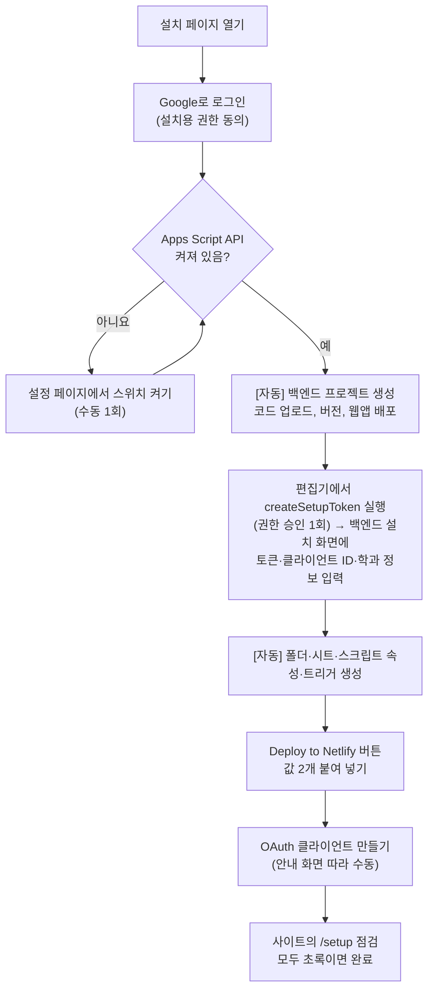

# 쉬운 설치 도구 설계 (브라우저 설치 마법사)

> 개발 단계: **③ 설계** · 산출물: 설치 흐름, 화면, 필요한 코드 변경, 남는 수동 단계
> 상태: 구현 완료, 2026-10-30 운영 반영(브랜치 `feature/easy-setup`). 설계와 달라진 점은 [§0](#0-구현-결과)에 있습니다. 구현 상태는 [STATUS.md](./STATUS.md)에서 관리합니다.

## 0. 구현 결과

아래 1~7절은 설계안 그대로 두고, 실제 구현에서 달라지거나 더해진 점만 적습니다.

| 항목 | 구현 |
|---|---|
| 설치 토큰 | 백엔드 설치 화면은 1회용 설치 토큰이 있어야 실행됩니다. 배포 계정이 편집기에서 `createSetupToken()`을 실행하면 스크립트 속성 `SETUP_TOKEN`에 저장되고 실행 로그에 찍힙니다. 이 첫 실행이 웹앱에 필요한 최초 권한 승인도 겸합니다. 설치가 끝나면 `SETUP_TOKEN`을 지우고 `SETUP_DONE`을 `true`로 둡니다 |
| 설치 안내 | 배포된 사이트의 `/install/`이 준비부터 첫 운영 체크리스트까지 0~14단계를 한 페이지에서 안내합니다. 진행 상태·주소·공개 설정값은 브라우저에 저장하고 Google 액세스 토큰과 설치 토큰은 저장하지 않습니다 |
| 배포 파일 | `public/install/`의 정적 페이지가 Vite 결과의 `dist/install/`에 포함되고, `npm run build`가 백엔드 코드를 묶어 `dist/backend-bundle.json`까지 만듭니다 |
| 설치용 OAuth | 설치 안내 사이트 운영자가 `VITE_INSTALL_CLIENT_ID` 또는 `public/install/config.js`에 별도 웹 클라이언트 ID를 설정합니다. 비어 있으면 마법사 상단에 운영자 안내를 표시하고 백엔드 자동 생성을 막습니다 |
| 한 번 배포 | 사이트 이름을 먼저 정해 Google OAuth 원본을 만들고, 백엔드 주소·운영 클라이언트 ID·그룹 JSON을 Netlify에 한 번에 넣습니다. 실제 Netlify 주소가 예정 주소와 다르면 OAuth 원본을 실제 주소로 고치도록 안내합니다 |
| 운영 시작 | 자동 점검 뒤 첫 관리자 로그인, 그룹 구성원 초대, 사용자 일괄 등록·승인, Testing 제한 안내문, 최종 체크리스트를 이어서 제공합니다 |
| 설치 화면 파일 | `appScript/SetupPage.html`. `Setup.gs`와 이름이 겹쳐 `Setup.html`에서 바꿨습니다 |
| 입력 항목 | Google OAuth 클라이언트 ID, 루트 폴더 이름, 그룹 이메일 5개, 첫 관리자 이메일, 설치 토큰. 클라이언트 ID는 스크립트 속성 `GOOGLE_CLIENT_ID`에 저장되고 서버 측 인가에 쓰입니다([ADR-015](./ADR.md#adr-015-apps-script가-액세스-토큰으로-요청자를-확인한다)). 운영 주체 명칭·문의 이메일 입력은 구현하지 않았습니다 |
| 설치 내용 | `installSystem`이 속성 저장 → `initializeSystem` → 첫 관리자 등록(승인·관리자 `O`)을 실행합니다. 관리자 키 트리거는 자동으로 만들지 않으므로 직접 등록합니다([DEPLOYMENT.md §3](./DEPLOYMENT.md#3-초기-세팅-drive-폴더시트-생성)) |
| 기존 설치 | `SPREADSHEET_ID`가 있고 `SETUP_TOKEN`이 없으면 설치된 것으로 봅니다. 설치 화면과 `createSetupToken`이 거부합니다 |
| `/setup` 점검 | OAuth 클라이언트 ID, 백엔드 연결(버전), 백엔드 설치, 회원 시트, **서버·사이트 클라이언트 ID 일치**, OAuth 자바스크립트 원본. 실패 항목의 ‘설치 안내 열기’가 `/install/#step-N`의 고칠 단계로 이동합니다 |

## 1. 목표

개발 지식이 없는 사람이 **자기 Google 계정으로 HP ERP를 처음부터 설치**할 수 있게 합니다. 기관마다 독립 설치(사이트, OAuth, Apps Script, Drive 데이터 모두 기관 소유)라는 전제는 그대로 둡니다.

| 지금 | 목표 |
|---|---|
| clasp 설치, 파일 40개 업로드, 스크립트 속성 수동 입력, 트리거 수동 등록, Netlify 환경변수 수동 입력 | 브라우저에서 버튼을 누르고, Google이 사람에게 요구하는 단계만 직접 함 |
| Node.js, 터미널 필요 | 브라우저만 필요 |

## 2. 사용자가 거치는 흐름

| 단계 | 자동 | 사용자 | 소요 |
|---|---|---|---|
| 1. 로그인 | 설치 페이지가 OAuth로 토큰 발급 | Google 계정 선택, 권한 허용 | 1분 |
| 2. API 스위치 | 켜졌는지 확인, 설정 페이지 링크 제공 | `script.google.com/home/usersettings`에서 스위치 켜기 | 1분 |
| 3. 백엔드 생성 | Apps Script API로 프로젝트 생성, 코드 업로드, 버전 생성, 웹앱 배포. 배포 주소 표시 | 없음 | 1분 |
| 4. 초기 구성 | 백엔드 설치 화면 실행 후 `initializeSystem`과 같은 작업 수행 | 권한 승인, 학과명·그룹 이메일·관리자 이메일 입력 | 3분 |
| 5. 사이트 | Netlify 버튼이 저장소 복사와 빌드 | Netlify 가입(GitHub 계정으로), 값 2개 붙여 넣기 | 5분 |
| 6. OAuth 클라이언트 | 붙여 넣을 값(원본 주소, 권한 목록) 표시, Console 해당 화면 링크 | 프로젝트·동의 화면·클라이언트 생성, 클라이언트 ID를 Netlify에 입력 | 10분 |
| 7. 점검 | `/setup`에서 항목별 확인 | 결과 확인 | 1분 |
| 8. 데스크톱 앱 (선택) | 기관 저장소의 GitHub Actions가 기관 사이트 주소를 넣은 설치 파일을 만들어 Releases에 올림 | 설치 마법사의 링크에서 설치 파일 받기 | 10분(빌드 대기) |

## 3. 구성 요소

### 3.1 설치 페이지 (새로 만듦)

- **위치:** `public/install/` 정적 페이지를 Vite 빌드에 포함해 운영 중인 설치 안내 사이트의 `/install/`에서 엽니다.
- **로그인:** 설치 전용 OAuth 클라이언트를 씁니다(본 앱과 다른 클라이언트). 요청 권한은 `script.projects`(프로젝트 생성·코드 업로드), `script.deployments`(웹앱 배포), `userinfo.email`입니다.
- **코드 묶음:** 릴리스할 때 `appScript/*.gs`와 `appsscript.json`을 JSON 하나(`backend-bundle.json`)로 묶어 함께 배포합니다. 설치 페이지는 이 파일을 그대로 업로드합니다.
- **Apps Script API 호출 순서:**
  1. `projects.create` (제목 `HP ERP Backend`)
  2. `projects.updateContent` (코드 묶음)
  3. `projects.versions.create`
  4. `projects.deployments.create` (웹앱. 실행 계정과 접근 권한은 매니페스트 `webapp` 설정을 따름)
- **실패 처리:** API가 꺼져 있으면 403 응답을 받아 2단계 안내로 돌아갑니다. 중간에 실패하면 이미 만든 프로젝트 ID를 보여 주고, 같은 프로젝트에서 이어서 진행합니다.

### 3.2 백엔드 설치 화면 (Apps Script에 추가)

- `doGet(?page=setup)`이 HTML 입력 화면을 돌려줍니다.
- 입력 항목: 학과·서비스 이름, 운영 주체 명칭, 문의 이메일, 루트 폴더 이름(기본값 제공), 그룹 이메일 5개(학생, 집행부, 교수, 겸임교원, 조교), 첫 관리자 이메일.
- 운영 주체 명칭과 문의 이메일은 개인정보처리방침·약관 페이지에 들어갑니다. 사이트 빌드 환경변수(예: `VITE_OPERATOR_NAME`, `VITE_SUPPORT_EMAIL`)로 넘기고, 비어 있으면 `/setup` 점검에서 빨강으로 표시합니다.
- **설치** 버튼을 누르면 다음을 차례로 실행하고 진행 상황을 단계별로 보여 줍니다.
  1. 폴더·시트 생성
  2. `SPREADSHEET_ID`·`ROOT_FOLDER_ID`·`GROUP_EMAIL_JSON` 저장
  3. 관리자 키 트리거 등록
  4. 첫 관리자 사전 등록
- 설치가 끝나면 화면을 잠급니다(`SETUP_DONE` 속성). 다시 열면 "설치됨"만 보입니다.
- 독립 프로젝트라 연결된 스프레드시트가 없습니다. 회원 시트는 `SPREADSHEET_ID` 속성으로 찾도록 맞춥니다(`getHpMemberSpreadsheet`).

### 3.3 사이트 배포 (Netlify 버튼)

- README와 설치 페이지에 `Deploy to Netlify` 버튼을 둡니다. 버튼을 누르면 사용자 GitHub에 저장소 사본이 생기고 Netlify가 빌드합니다.
- `netlify.toml`에 `[template.environment]`를 넣어, 배포할 때 `APP_SCRIPT_URL`과 `VITE_GOOGLE_CLIENT_ID` 입력 칸이 뜨게 합니다.
- 6단계 전에는 OAuth 클라이언트 ID가 없으므로, 처음에는 비워 두고 6단계 후 Netlify 환경변수에서 넣고 다시 배포하게 안내합니다.

### 3.4 점검 화면 `/setup` (앱에 추가)

로그인 없이 볼 수 있고, 비밀값은 보여 주지 않습니다.

| 점검 | 방법 | 실패 시 안내 |
|---|---|---|
| 클라이언트 ID 설정 | 빌드 값이 비었는지 | Netlify 환경변수 입력 후 재배포 |
| 백엔드 연결 | 프록시로 상태 확인 액션 호출 | `APP_SCRIPT_URL` 확인, 웹앱 배포 접근 권한 확인 |
| 백엔드 설치 완료 | 응답의 `SETUP_DONE` | 백엔드 설치 화면 다시 열기 |
| 시트 찾기 | `getSpreadsheetIds` 결과에 빈 값 없음 | `clearSpreadsheetIdCache` 실행 |
| OAuth 원본 등록 | 로그인 시도 결과 | Console에 현재 사이트 주소 추가 |

### 3.5 데스크톱 설치 파일 (Electron)

각 기관이 자기 사이트에 연결되는 데스크톱 앱 설치 파일을 받을 수 있게 합니다.

- **동작 방식:** 패키징한 앱은 로컬 `dist/index.html`을 `file://`로 여는 대신 **기관 사이트 주소를 창에 띄웁니다**(`loadURL`). 지금 방식은 `file://`에서 Google 로그인 리디렉션과 Netlify 프록시가 동작하지 않습니다([ADR-011](./ADR.md#adr-011-electron은-같은-번들을-감싸는-선택-배포로-둔다)). 사이트를 띄우면 로그인과 API가 웹과 똑같이 동작하고, OAuth 클라이언트에 원본을 따로 추가할 필요도 없습니다.
- **기관 주소 넣기:** 빌드할 때 `HP_ERP_SITE_URL` 값을 앱 설정에 넣습니다. 값이 없으면 첫 실행 때 주소를 묻고 저장합니다.
- **설치 파일 만들기:** Netlify 버튼으로 생긴 기관 저장소 사본에서 GitHub Actions 워크플로가 Windows(NSIS)와 macOS(dmg) 설치 파일을 만들어 Releases에 올립니다. 설치 마법사 마지막 화면에 "설치 파일 만들기" 버튼(워크플로 실행 링크)과 다운로드 링크를 둡니다.
- **보안 설정 정리:** 지금 `electron/main.cjs`의 `webSecurity: false` 등 보안 해제 옵션을 끄고, 외부 링크는 기본 브라우저로 엽니다. 원격 사이트를 띄우므로 Node 통합은 쓰지 않습니다.
- **서명:** 코드 서명 인증서가 없으면 Windows에서 SmartScreen 경고, macOS에서 실행 차단이 뜹니다. 인증서는 유료라 기본은 서명 없이 만들고, 설치 가이드에 경고 화면 넘기는 방법을 넣습니다.
- **업데이트:** 화면은 사이트에서 불러오므로 기능 업데이트는 사이트 배포만으로 반영됩니다. 설치 파일을 다시 받을 일은 Electron 자체 업데이트 때뿐입니다.

## 4. 남는 수동 단계와 이유

| 단계 | 자동화가 안 되는 이유 |
|---|---|
| Apps Script API 스위치 | 사용자 계정 설정이라 API로 켤 수 없음 |
| 권한 승인 화면 | Google이 사람의 동의를 요구 |
| Google Cloud 프로젝트·OAuth 클라이언트 생성 | 웹 OAuth 클라이언트를 만드는 공개 API가 없음 |
| Netlify·GitHub 가입 | 계정 소유자 확인 필요 |
| 앱 인증 신청 | Google 심사. [OAUTH_PUBLISHING.md](./OAUTH_PUBLISHING.md) 절차를 따름 |

## 5. 설치 페이지 자체의 OAuth

- `script.projects`, `script.deployments`는 Google이 민감한 범위로 분류할 가능성이 큽니다(구현 전 확인).
- 설치 페이지는 기관당 한 번만 쓰입니다. 인증을 받지 않으면 미인증 경고가 뜨고, 신규 사용자 수에 평생 상한(100명)이 걸립니다.
- 설치할 기관이 많아지면 설치 페이지도 인증을 받아야 합니다. 그 전에는 경고 화면 넘기는 방법을 안내합니다.

## 6. 구현 작업 목록 (Codex)

| 순서 | 작업 | 위치 |
|---|---|---|
| 1 | `getHpMemberSpreadsheet`를 `SPREADSHEET_ID` 속성 우선으로 변경 (독립 프로젝트 대응) | `appScript/SpreadsheetCore.gs` |
| 2 | 백엔드 설치 화면(`doGet ?page=setup`)과 설치 함수, `SETUP_DONE` 잠금 | `appScript/` 새 파일 + `Main.gs` |
| 3 | 상태 확인 액션(설치 여부, 버전) | `appScript/Main.gs` |
| 4 | 코드 묶음 생성 스크립트(`npm run bundle:backend` → `backend-bundle.json`) | `scripts/` |
| 5 | 설치 페이지(정적 HTML + JS, Apps Script API 호출) | `install/` |
| 6 | Netlify 배포 버튼과 `[template.environment]` | `netlify.toml`, README |
| 7 | 점검 화면 `/setup` | `src/` |
| 8 | Electron: 기관 사이트 주소 로드, 첫 실행 주소 입력, 보안 옵션 정리, 외부 링크 처리 | `electron/main.cjs` |
| 9 | 설치 파일 빌드 워크플로(Windows·macOS, 기관 주소는 저장소 변수) | `.github/workflows/` |
| 10 | 정책 페이지의 운영 주체·문의 이메일·서비스명을 기관별 값으로 주입 | `public/privacy.html`, `public/terms.html`, 빌드 설정 |

## 7. 검증 계획 (Claude)

1. 새 Google 계정, 새 GitHub·Netlify 계정, 설치 프로그램 없는 PC로 설치 페이지부터 끝까지 따라 합니다.
2. 단계마다 걸린 시간과 막힌 지점을 기록합니다.
3. 그 기록으로 그림이 있는 설치 가이드(`docs/INSTALL_GUIDE.md`)를 씁니다.
4. 실패 상황(API 꺼짐, 권한 거부, 중간 중단 후 재시작, 잘못된 배포 주소)을 일부러 만들어 안내 문구를 확인합니다.
5. 데스크톱 설치 파일을 Windows에서 설치해 로그인, 주요 화면, 로그아웃이 웹과 같게 동작하는지 확인합니다.
