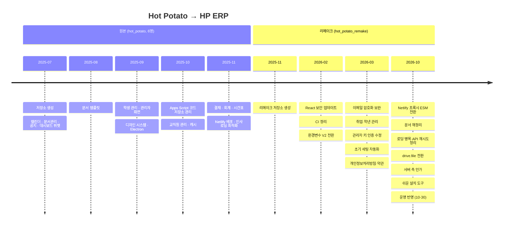

# HP ERP 구현 상태

> 개발 단계: **⑤ 구현 / ⑦ 수정 및 문서화** · 산출물: 구현 현황, 기술 백로그
> **구현 상태는 이 문서에서만 관리합니다.** 다른 문서에는 상태를 적지 않고 여기로 링크합니다.

## 1. 기준 시점

| 항목 | 값 |
|---|---|
| 기준일 | 2026-10-30 |
| 커밋 | `main` @ `c2b8a6c` (develop 운영 반영: drive.file 전환, 서버 측 인가, 쉬운 설치 도구, QA 수정) |
| 운영 주소 | https://yuhancse.netlify.app |
| Apps Script 운영 배포 | @59 (같은 배포 ID를 @34에서 올림). 되돌리기는 [DEPLOYMENT.md §7](./DEPLOYMENT.md#7-변경-배포) |
| OAuth 클라이언트 | 운영 계정 소유 프로젝트의 `651515712118-…` ([OAUTH_PUBLISHING.md](./OAUTH_PUBLISHING.md)). 앱은 아직 테스트 상태라 사용자에게 확인되지 않은 앱 경고가 보임 |
| 마지막 검증 | [TEST_PLAN.md §9.4](./TEST_PLAN.md#94-develop-qa와-서버-측-인가-검증-2026-10-30) (develop QA, 서버 측 인가, 운영 배포 후 확인). 이전 검증은 [§8](./TEST_PLAN.md#8-로딩-성능-개선-검증-2026-10-29-featureloading-performance), [§9.1](./TEST_PLAN.md#91-결과) |

## 2. 기능별 상태

✅ 동작 · ⚠️ 동작하지만 알려진 결함 있음 · ⏳ 미구현

| 영역 | 기능 | 상태 | 비고 |
|---|---|---|---|
| 인증 | Google 로그인, 최근 계정 로그인 | ✅ | 세션 최대 약 1시간 |
| 인증 | 서버 측 인가 (요청마다 토큰 확인, 공개·회원·관리자 액션 구분) | ✅ | [ADR-015](./ADR.md#adr-015-apps-script가-액세스-토큰으로-요청자를-확인한다). 장부 목록 첫 로딩이 느려지는 원인 중 하나 |
| 인증 | 가입 신청, 사전 등록, 승인 | ✅ | 승인 후 재로그인 필요 (BUG-08) |
| 인증 | 가입 거부 | ✅ | BUG-02 해결. 거부하면 `R`로 기록되고 다시 신청할 수 있음 |
| 인증 | 관리자 키 갱신·발송 | ✅ | 트리거 수동 등록 필요 |
| 인증 | 로그인 화면 서비스 설명, 소개·개인정보처리방침·이용약관 링크 | ✅ | 로그인 버튼 문구 "Google 계정으로 로그인" |
| 대시보드 | 위젯 추가·삭제·정렬, 개인 드라이브 저장 | ⚠️ | 첫 동기화 전에 "위젯이 없습니다"가 잠깐 보임 |
| 공지 | 목록·상세·작성·수정·삭제, 공개 범위, 첨부·이미지 | ✅ | 첨부는 공개 범위 대상(그룹·개인)에게만 보기 권한으로 공유. 공개 링크 아님 |
| 공지 | 고정 요청·승인 | ✅ | |
| 문서 | 공유·개인 문서 목록, 업로드, 삭제 | ✅ | 공유 문서는 만든 사람만 삭제(휴지통 이동) |
| 문서 | 양식으로 생성 (나만 보기 / 권한 부여) | ⚠️ | 권한 부여 경로는 태그 메타데이터를 저장하지 않음 |
| 문서 | 공유 양식·공용 태그·개인 태그·즐겨찾기 | ✅ | |
| 결재 | 요청 3유형, 검토·결재 승인, 보류·재개 | ✅ | |
| 결재 | 검토 단계 반려 | ✅ | BUG-01 해결 |
| 결재 | 결재 단계 반려, 재상신, 이력, 결재선 템플릿 | ✅ | |
| 회계 | 장부 생성, 입출금, 증빙, 잔액 계산 | ⚠️ | 항목 삭제 행 어긋남과 과거 날짜 항목 잔액 오류는 수정됨. 장부 목록 첫 로딩이 약 15초 걸림 |
| 회계 | 카테고리 | ⚠️ | BUG-07 |
| 회계 | 예산 계획 검토·승인·집행 | ✅ | BUG-04 해결. 열을 헤더 이름으로 읽고, 부관리인이 없는 통장도 검토로 넘어감. 기존 장부는 `migrateBudgetPlanColumns` 실행(2026-10-30 운영 실행 완료) |
| 회계 | 장부 내보내기 | ✅ | 양식 미리보기는 Apps Script `getTemplateSheetPreview` |
| 일정 | 역할별 캘린더 통합, 일정 CRUD, 반복 일정, 학사 일정 | ✅ | BUG-03 해결 |
| 일정 | 개인 시간표 | ✅ | |
| 학생 | 목록·상세·추가·수정, 학생회 | ✅ | |
| 학생 | 학년 갱신·유급·진학 (조교) | ✅ | 되돌리기 없음 |
| 학생 | 비로그인 취업 정보 입력, 직종 분야 | ✅ | |
| 교직원 | 교직원·위원회 관리 | ✅ | 교직원 조회 시트, 위원회 조회·쓰기 시트 불일치 수정 |
| 공통 | 오프라인 배너, 오류 경계, 캐시·프리페치 | ✅ | BUG-06, BUG-13 해결 |
| 공통 | 개인정보처리방침·이용약관 페이지 | ✅ | |
| 공통 | 만들기·수정·삭제 후 즉시 갱신, 서버 대기 중 표시, 공통 확인 모달 | ✅ | |
| 배포 | 웹 (Netlify) | ⚠️ | JSON 환경변수 4개가 `{`만 저장되어 있어 코드 기본값으로 동작 중 (2026-10-29 확인, §4 백로그) |
| 배포 | 쉬운 설치 (설치 페이지, 설치 토큰, `/setup` 진단) | ⚠️ | 운영 사이트의 `/setup` 화면에 스타일이 적용되지 않음 |
| 배포 | 데스크톱 (Electron) | ⚠️ | 패키징 앱의 로그인·API 경로 미검증 |
| 미사용 | 채팅(`Chat.tsx`), 회의록(`proceedings`) | ⏳ | 메뉴에 연결 안 됨 |

결함 상세는 [TEST_PLAN.md §6](./TEST_PLAN.md#6-결함-리포트-테스트코드-점검으로-발견)에 있습니다.

## 3. 프로젝트 이력

| 구분 | 기간 | 커밋 | 참여 |
|---|---|---|---|
| 원본 `semicolon213/hot_potato` | 2025-07-08 ~ 2025-12-01 | 666 | 6명 |
| 리메이크 `semicolon213/hot_potato_remake` | 2025-11-26 ~ 진행 중 | 35 (2026-10-22 기준) | 4명 |

리메이크에서 바뀐 것:

| 변경 | 내용 |
|---|---|
| 환경변수 V2 | 폴더·시트 이름을 JSON 환경변수 4개로 통합. Apps Script는 스크립트 속성으로 이전 ([ADR-006](./ADR.md#adr-006-폴더시트-이름을-json-환경변수로-관리한다)) |
| 루트 폴더 기준 탐색 | 스프레드시트를 드라이브 전체가 아니라 루트 폴더 아래에서만 찾도록 변경. 환경변수 값 우선 |
| 초기 세팅 자동화 | `initializeSystem()` 한 번으로 폴더·시트·스크립트 속성 생성 |
| 학적 기능 추가 | 학년 갱신, 유급, 진학, 비로그인 취업 정보 입력 |
| 관리자 가입 검증 | 관리자 가입 요청을 서버에서도 확인하도록 보강 |
| 프록시 개선 | ESM 전환, 서버 전용 `APP_SCRIPT_URL`(없으면 `VITE_APP_SCRIPT_URL`), 비JSON 응답 처리, 405·400 응답 |
| 법적 고지 | 개인정보처리방침, 이용약관 페이지 |
| CI | GitHub Actions 삭제, Netlify 빌드로 대체 ([ADR-012](./ADR.md#adr-012-ci를-걷어내고-netlify-빌드를-배포-게이트로-쓴다)) |
| drive.file 전환 (브랜치 `feature/drive-file-scope`, 2026-10-30 운영 반영) | OAuth 범위를 `drive.file`, `spreadsheets`, `calendar.events`, `calendar.readonly`, `profile`, `email`로 축소하고 `gmail.compose`, `documents` 제거 ([OAUTH_PUBLISHING.md](./OAUTH_PUBLISHING.md)). 배포자 소유 공유 파일을 다루는 일(공지 첨부·본문 이미지, 회계 증빙 업로드, 장부 목록, 공유 양식으로 나만 보기 문서 만들기, 장부 내보내기)을 Apps Script 경유로 전환. 개인 데이터는 내 드라이브 `hot_potato_personal/`로 분리. `papyrus-db`를 자체 모듈 `sheetsClient.ts`로 교체. 루트 폴더를 `hp_member` 부모 폴더로 감지. `initializeSystem`이 역할 폴더를 그룹스에 공유. 그룹 이메일 기본값을 `student_hp`, `std_council_hp`, `professor_hp`, `adj_professor_hp`, `assistant_hp`(@googlegroups.com)로 정리. 장부 목록을 접근 대상에게만 표시. 캘린더 역할 키 통일(BUG-03). 공지 등록·결재 상태 변경·학년 갱신에 `LockService` 적용. Drive 권한 호출을 v3 형식으로 정리. 로그 수준 정리 |
| 로딩 성능 (브랜치 `feature/loading-performance`, 2026-10-30 운영 반영) | 스프레드시트 ID를 Drive 검색 1회 + 서버 캐시 6시간으로 조회 ([ADR-013](./ADR.md#adr-013-스프레드시트-id를-drive-검색-1회와-서버-캐시로-찾는다)). `apiClient` 재시도 재설계(시도마다 타임아웃 30초, 최대 2회 재시도, 쓰기 요청 재시도 안 함). 프록시 상류 타임아웃 약 9초 → 504. 측정 결과는 [TEST_PLAN.md §8](./TEST_PLAN.md#8-로딩-성능-개선-검증-2026-10-29-featureloading-performance) |
| 쉬운 설치 (브랜치 `feature/easy-setup`, 2026-10-30 운영 반영) | 브라우저 설치 페이지(`install/`), Apps Script 설치 화면(`SetupPage.html`), 설치 진단 화면(`/setup`). 설치는 편집기에서 만든 1회용 설치 토큰으로 보호하고, Google OAuth 클라이언트 ID를 스크립트 속성 `GOOGLE_CLIENT_ID`에 저장 ([EASY_SETUP_DESIGN.md](./EASY_SETUP_DESIGN.md)) |
| 서버 측 인가 (2026-10-30 운영 반영) | 모든 요청에 액세스 토큰을 담고 Apps Script가 Google tokeninfo로 확인. 역할·관리자 여부는 `hp_member`에서 읽음 ([ADR-015](./ADR.md#adr-015-apps-script가-액세스-토큰으로-요청자를-확인한다)) |
| develop QA 수정 (브랜치 `fix/develop-qa`, 2026-10-30 운영 반영) | 공유 문서 삭제·양식 내보내기 범위 제한, 시스템 스프레드시트 소유자 확인, 공지 첨부·증빙 업로드 검증, 공지 첨부 공개 범위 공유, 장부 행 삭제·과거 항목 잔액·위원회 시트 수정, BUG-01·02·04 수정 ([TEST_PLAN.md §9.4](./TEST_PLAN.md#94-develop-qa와-서버-측-인가-검증-2026-10-30)) |

## 4. 기술 백로그

우선순위: **P1** 다음 배포 전 · **P2** 이번 학기 · **P3** 여유 있을 때

| 우선순위 | 항목 | 관련 |
|---|---|---|
| P1 | Netlify의 JSON 환경변수 4개(`VITE_FOLER_NAME`, `VITE_SPREADSHEET_NAME`, `VITE_SHEET_NAME`, `VITE_GROUP_EMAIL`)를 한 줄 JSON으로 고치거나 삭제. 지금은 값이 `{`뿐이라 파싱이 조용히 실패하고 코드 기본값이 쓰임 | [DEPLOYMENT.md §4](./DEPLOYMENT.md#4-netlify) |
| P1 | OAuth 앱 인증 제출 (Search Console, 브랜딩, 데이터 액세스, 시연 영상, 인증 센터). 운영 계정 소유 프로젝트에서 진행 | [OAUTH_PUBLISHING.md](./OAUTH_PUBLISHING.md) |
| P2 | 장부 목록 첫 로딩 약 15초 단축 (서버 측 인가가 요청마다 tokeninfo 확인과 회원 조회를 더함) | [ADR-015](./ADR.md#adr-015-apps-script가-액세스-토큰으로-요청자를-확인한다) |
| P2 | 첫 동기화 전 대시보드에 "위젯이 없습니다"가 보이지 않게 로딩 상태 구분 | [TEST_PLAN.md §9.2](./TEST_PLAN.md#92-발견한-문제) ⑨ |
| P2 | 운영 사이트 `/setup` 화면 스타일 적용 | [EASY_SETUP_DESIGN.md](./EASY_SETUP_DESIGN.md) |
| P2 | 결재 상태 타입을 서버 값과 일치 | BUG-05 |
| P2 | 카테고리 조회 시트 수정 | BUG-07 |
| P2 | 페이지 단위 권한 검사 | [ADR-010](./ADR.md#adr-010-라우터-없이-상태-기반으로-화면을-전환한다) |
| P2 | `type-check` 스크립트 수정, 테스트 스위트 복구, CI 재도입 | [TEST_PLAN.md §7](./TEST_PLAN.md#7-회귀-테스트-자동화-계획) |
| P2 | 승인 대기 화면 자동 재확인 | BUG-08 |
| P2 | `initializeSystem` 실패 집계 | BUG-09 |
| P3 | Authorization Code + PKCE 로그인으로 전환 (세션 유지) | [SECURITY.md §5](./SECURITY.md#5-개선-계획) |
| P3 | Apps Script 응답 형식 `{success, data, message}` 통일, 중복 분기·중복 전역 함수 제거 | [API_SPEC.md §3](./API_SPEC.md#3-정리가-필요한-부분) |
| P3 | 백엔드에 없는 프론트 액션 상수 정리 | [API_SPEC.md §3](./API_SPEC.md#3-정리가-필요한-부분) |
| P3 | `dataSyncService ↔ papyrusManager` 순환 참조 제거 (`papyrusManager`는 내부적으로 `sheetsClient`를 씀) | [ARCHITECTURE.md §8.1](./ARCHITECTURE.md#81-프론트엔드-src) |
| P3 | 레거시 문서 시트(`학생_문서관리` 등) 참조 제거 | [DATA_MODEL.md §6](./DATA_MODEL.md#6-알려진-불일치-정리-대상) |
| P3 | Apps Script 동시 쓰기에 `LockService` 적용. 공지 등록·결재 상태 변경·학년 갱신·유급 변경은 적용됨. 나머지 쓰기는 남음 | |
| P3 | 증빙 업로드에도 공지 첨부처럼 허용 파일 형식 목록 적용 (지금은 크기·폴더·장부 접근만 검사) | [API_SPEC.md §2.6](./API_SPEC.md#26-회계) |
| P3 | 예전 공개 링크 공지 첨부 중 배포자가 관리할 수 없는 사용자 소유 파일 4개 정리 (그대로 두기로 결정) | [RUNBOOK.md RB-10](./RUNBOOK.md#rb-10-예전-공지-첨부가-링크만-있으면-누구나-열림) |
| P3 | 스프레드시트 파일을 교체·이동한 뒤 `clearSpreadsheetIdCache()`를 잊으면 서버가 최대 6시간 옛 ID를 돌려줌. 자동 무효화 방법 검토 | [ADR-013](./ADR.md#adr-013-스프레드시트-id를-drive-검색-1회와-서버-캐시로-찾는다) |
| P3 | 프록시 타임아웃이 Apps Script 응답 본문 읽기까지는 제한하지 않음 (위험 낮음) | [ADR-004](./ADR.md#adr-004-apps-script-앞에-netlify-function-프록시를-둔다) |
| P3 | Electron 패키징 앱의 OAuth·API 경로 지원 | [ADR-011](./ADR.md#adr-011-electron은-같은-번들을-감싸는-선택-배포로-둔다) |
| P3 | `package-lock.json`과 `bun.lock` 중 하나로 정리 | |

완료해 백로그에서 뺀 항목 (2026-10-30 운영 반영): `feature/loading-performance`·`feature/drive-file-scope` 병합과 재배포, 서버 측 인가, BUG-01·02·03·04·06·13, `APP_SCRIPT_URL` 확인(프록시가 없으면 `VITE_APP_SCRIPT_URL`을 씀), 로그아웃 시 캐시·사용자 데이터 삭제.
