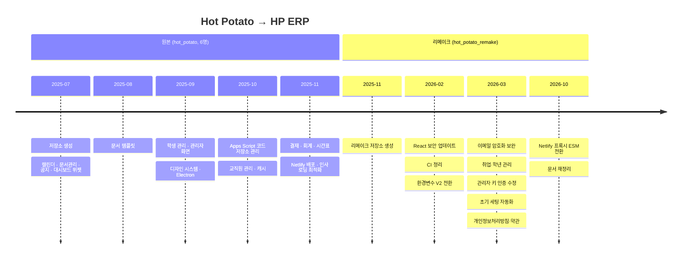

# HP ERP 구현 상태

> 개발 단계: **⑤ 구현 / ⑦ 수정 및 문서화** · 산출물: 구현 현황, 기술 백로그
> **구현 상태는 이 문서에서만 관리합니다.** 다른 문서에는 상태를 적지 않고 여기로 링크합니다.

## 1. 기준 시점

| 항목 | 값 |
|---|---|
| 기준일 | 2026-10-27 |
| 커밋 | `main` @ `6ad8486` (netlify 빌드 수정) |
| 운영 주소 | https://yuhancse.netlify.app |
| 마지막 검증 | [TEST_PLAN.md §4](./TEST_PLAN.md#4-자동-검사-결과-2026-10-27-main--6ad8486) |

## 2. 기능별 상태

✅ 동작 · ⚠️ 동작하지만 알려진 결함 있음 · ⏳ 미구현

| 영역 | 기능 | 상태 | 비고 |
|---|---|---|---|
| 인증 | Google 로그인, 최근 계정 로그인 | ✅ | 세션 최대 약 1시간 |
| 인증 | 가입 신청, 사전 등록, 승인 | ✅ | 승인 후 재로그인 필요 (BUG-08) |
| 인증 | 가입 거부 | ⚠️ | BUG-02 |
| 인증 | 관리자 키 갱신·발송 | ✅ | 트리거 수동 등록 필요 |
| 대시보드 | 위젯 추가·삭제·정렬, 개인 드라이브 저장 | ✅ | |
| 공지 | 목록·상세·작성·수정·삭제, 공개 범위, 첨부·이미지 | ✅ | |
| 공지 | 고정 요청·승인 | ✅ | |
| 문서 | 공유·개인 문서 목록, 업로드 | ✅ | |
| 문서 | 양식으로 생성 (나만 보기 / 권한 부여) | ✅ | 권한 부여 경로는 태그 메타데이터를 저장하지 않음 |
| 문서 | 공유 양식·공용 태그·개인 태그·즐겨찾기 | ✅ | |
| 결재 | 요청 3유형, 검토·결재 승인, 보류·재개 | ✅ | |
| 결재 | 검토 단계 반려 | ⚠️ | BUG-01 |
| 결재 | 결재 단계 반려, 재상신, 이력, 결재선 템플릿 | ✅ | |
| 회계 | 장부 생성, 입출금, 증빙, 잔액 계산 | ✅ | |
| 회계 | 카테고리 | ⚠️ | BUG-07 |
| 회계 | 예산 계획 검토·승인·집행 | ⚠️ | BUG-04. 부관리인이 없는 통장은 검토 단계로 못 넘어감 |
| 회계 | 장부 내보내기 | ✅ | |
| 일정 | 역할별 캘린더 통합, 일정 CRUD, 반복 일정, 학사 일정 | ⚠️ | BUG-03 (집행부·겸임교원 캘린더) |
| 일정 | 개인 시간표 | ✅ | |
| 학생 | 목록·상세·추가·수정, 학생회 | ✅ | |
| 학생 | 학년 갱신·유급·진학 (조교) | ✅ | 되돌리기 없음 |
| 학생 | 비로그인 취업 정보 입력, 직종 분야 | ✅ | |
| 교직원 | 교직원·위원회 관리 | ✅ | |
| 공통 | 오프라인 배너, 오류 경계, 캐시·프리페치 | ✅ | |
| 공통 | 개인정보처리방침·이용약관 페이지 | ✅ | |
| 배포 | 웹 (Netlify) | ✅ | |
| 배포 | 데스크톱 (Electron) | ⚠️ | 패키징 앱의 로그인·API 경로 미검증 |
| 미사용 | 채팅(`Chat.tsx`), 회의록(`proceedings`) | ⏳ | 메뉴에 연결 안 됨 |

결함 상세는 [TEST_PLAN.md §6](./TEST_PLAN.md#6-결함-리포트-테스트코드-점검으로-발견)에 있습니다.

## 3. 프로젝트 이력

| 구분 | 기간 | 커밋 | 참여 |
|---|---|---|---|
| 원본 `semicolon213/hot_potato` | 2025-07-08 ~ 2025-12-01 | 666 | 6명 |
| 리메이크 `semicolon213/hot_potato_remake` | 2025-11-26 ~ 진행 중 | 35 (2026-10-22 기준) | 4명 |

리메이크에서 바뀐 것:

| 변경 | 내용 |
|---|---|
| 환경변수 V2 | 폴더·시트 이름을 JSON 환경변수 4개로 통합. Apps Script는 스크립트 속성으로 이전 ([ADR-006](./ADR.md#adr-006-폴더시트-이름을-json-환경변수로-관리한다)) |
| 루트 폴더 기준 탐색 | 스프레드시트를 드라이브 전체가 아니라 루트 폴더 아래에서만 찾도록 변경. 환경변수 값 우선 |
| 초기 세팅 자동화 | `initializeSystem()` 한 번으로 폴더·시트·스크립트 속성 생성 |
| 학적 기능 추가 | 학년 갱신, 유급, 진학, 비로그인 취업 정보 입력 |
| 관리자 가입 검증 | 관리자 가입 요청을 서버에서도 확인하도록 보강 |
| 프록시 개선 | ESM 전환, 서버 전용 `APP_SCRIPT_URL`, 비JSON 응답 처리, 405·400 응답 |
| 법적 고지 | 개인정보처리방침, 이용약관 페이지 |
| CI | GitHub Actions 삭제, Netlify 빌드로 대체 ([ADR-012](./ADR.md#adr-012-ci를-걷어내고-netlify-빌드를-배포-게이트로-쓴다)) |

## 4. 기술 백로그

우선순위: **P1** 다음 배포 전 · **P2** 이번 학기 · **P3** 여유 있을 때

| 우선순위 | 항목 | 관련 |
|---|---|---|
| P1 | 서버 측 인가 강화 (비공개 보안 과제) | [SECURITY.md §5](./SECURITY.md#5-개선-계획) |
| P1 | 검토 반려 오류 수정 | BUG-01 |
| P1 | 가입 거부를 현재 시트 구조로 수정 | BUG-02 |
| P1 | 예산계획 열 순서 통일 + 기존 장부 마이그레이션 | BUG-04 |
| P2 | 캘린더 역할 키 통일 | BUG-03 |
| P2 | 결재 상태 타입을 서버 값과 일치 | BUG-05 |
| P2 | `apiClient` 재시도: 시도마다 새 타임아웃, 쓰기 요청은 재시도 안 함 | BUG-06 |
| P2 | 카테고리 조회 시트 수정 | BUG-07 |
| P2 | 페이지 단위 권한 검사 | [ADR-010](./ADR.md#adr-010-라우터-없이-상태-기반으로-화면을-전환한다) |
| P2 | 로그아웃 시 캐시·사용자 데이터 삭제 | [ADR-005](./ADR.md#adr-005-클라이언트-캐시와-2단계-프리페치) |
| P2 | `type-check` 스크립트 수정, 테스트 스위트 복구, CI 재도입 | [TEST_PLAN.md §7](./TEST_PLAN.md#7-회귀-테스트-자동화-계획) |
| P2 | 승인 대기 화면 자동 재확인 | BUG-08 |
| P2 | `initializeSystem` 실패 집계 | BUG-09 |
| P3 | Authorization Code + PKCE 로그인으로 전환 (세션 유지) | [SECURITY.md §5](./SECURITY.md#5-개선-계획) |
| P3 | Apps Script 응답 형식 `{success, data, message}` 통일, 중복 분기·중복 전역 함수 제거 | [API_SPEC.md §3](./API_SPEC.md#3-정리가-필요한-부분) |
| P3 | 백엔드에 없는 프론트 액션 상수 정리 | [API_SPEC.md §3](./API_SPEC.md#3-정리가-필요한-부분) |
| P3 | `dataSyncService ↔ papyrusManager` 순환 참조 제거 | [ARCHITECTURE.md §8.1](./ARCHITECTURE.md#81-프론트엔드-src) |
| P3 | 레거시 문서 시트(`학생_문서관리` 등) 참조 제거 | [DATA_MODEL.md §6](./DATA_MODEL.md#6-알려진-불일치-정리-대상) |
| P3 | Apps Script 동시 쓰기에 `LockService` 적용 | |
| P3 | Electron 패키징 앱의 OAuth·API 경로 지원 | [ADR-011](./ADR.md#adr-011-electron은-같은-번들을-감싸는-선택-배포로-둔다) |
| P3 | `package-lock.json`과 `bun.lock` 중 하나로 정리 | |
